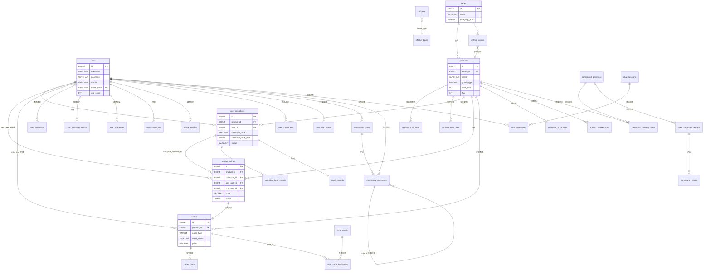

# 青川数字艺术 H5 平台 · 数据库 Schema 设计

> 版本：v1.1 · 勘察日期 2026-10-17
> **状态：已定稿（2026-10-17），A~E 裁决已确认**（详见 §10）
> 依据：`public/mock/` 下 78 个 JSON（源站 API 真实响应快照）+ `src/api/index.js` 接口清单 + `src/pages/` 105 个页面源码字段消费实测
> 铁律：字段严格来自 mock 实测；设计新增字段均显式标注「设计新增」
> 配套建表脚本：`docs/schema.sql`（MySQL 8.0，48 张表）

---

## 0. 勘察方法与可信度声明

| 勘察动作 | 覆盖度 | 方法 |
|---|---|---|
| 读取 mock JSON | 78/78（100%） | 逐文件读取结构与枚举取值 |
| 接口清单确认 | 100% | `src/api/index.js` MOCK_MAP 全量比对 |
| 页面字段消费 | 105 页全量清单 + 核心页精读 | `CollectionDetails.vue` / `OrderList.vue` / `market/Detail.vue` 等逐字段 grep |
| 枚举文案反查 | 14 个枚举 | 从前端 `STATUS_MAP` / 条件渲染反推源站语义 |

**关于你提供的勘察事实**，我验证结果如下（3 处修正）：

| 你的结论 | 验证结果 | 证据 |
|---|---|---|
| `goods_type` 1/2 语义待判 | **已定论**：1=盲盒（含概率池），2=单品 | `productDetail.data.product.collectionlist` 存在且 `goods_type:1`；`myCollectionDetail.data.product` 无概率池且 `goods_type:2` |
| `collection_code` 仅 int/str 两种 | **实为 3 套编码体系**，不止两种 | ① `QC88231` ② `QC20261013000137`（日期流水）③ `PBCE/2000000000000001`（链上凭证，regiftRecord） |
| `user_hash` 是合约地址 | **不完全成立**：部分接口的 `user_hash` 本身即脱敏值 | `marketDetail.user_collection.user_hash = "7Ep3Gz****"` 与 `user_hash_text` 完全相同 |

---

## 1. 响应封装风格（API 层职责，不影响表设计）

源站并存 **5 种**顶层封装，实测分类：

| 风格 | 结构特征 | mock 实例 |
|---|---|---|
| A. 裸数组 | `data: []` | `marketList` `flowDoc` `leaderboard` `activityRecord` 等 24 个 |
| B. 标准分页 | `data:{total,per_page,current_page,last_page,data:[]}` | `orderList` `afficheList` `banner_show_getBanner` |
| C. 精简分页 | `data:{total,data:[]}` | `marketGoodsList` `entrustList` `myConsignment` `invitationRecord` |
| D. 单对象 | `data:{...}` | `myCollectionDetail` `marketDetail` `productDetail` `tradeBaseInfo` |
| E. 嵌套混合 | `data:{product:{}, ...分页}` | `marketGoodsList.data.product` 与 `data.data[]` 并存 |

**设计决策**：数据库按规范关系模型存储，分页/封装由 API 序列化层还原。上表 D/E 风格的嵌套对象（如 `marketDetail.data.product`）在库中是 `products` 表的**外键引用**，不做 JSON 内嵌存储——唯一例外是 `diypage.content`，因其本质是前端布局 DSL，必须原样存 `TEXT`。

---

## 2. 领域划分（78 个 API → 7 域）

| 域 | 表数 | 覆盖的 mock / API |
|---|---|---|
| **A. 用户与账户** | 4 | `user.json`(login/register/getUserInfo)、`invitationInfo`、`invitationRecord`、`invitationAssist`、`addressList`、`getConfig`(用户侧 `score`/`yao_count`) |
| **B. 藏品与系列**（核心域） | 7 | `myCollectionDetail`、`myCollectionList`、`userCollectionList`、`sellInfo`、`giftRecord`、`productDetail`、`productRule`、`marketGoodsList`(product 段)、`series-10`、`series-10-pid`、`categoryManager`、`blindBoxMyBox`、`blindBoxResultOne` |
| **C. 交易与订单** | 6 | `marketDetail`、`marketList`、`market_market_getMarketList`、`tradeBaseInfo`、`tradeUnion`、`klineInfo`、`orderList`、`orderDetail`、`entrustList`、`begList`、`consignList`、`myConsignment`、`flowDoc` |
| **D. 活动与玩法** | 14 | `activeSelectedList`、`compoundList/Scheme/Record/Result`、`lotteryInfo/Record/Rule`、`activityDraw`、`drawResult`、`activityRecord`、`drawLeaderboard`、`signInfo`、`shopList`、`shopGoodsDetail`、`shopBoxDetail`、`shopCollectionDetail`、`shopExchangeRecord`、`shopCrystalDetail`、`blindBoxList`、`box_blind_box_list` |
| **E. 内容与社区** | 10 | `wallDetails`、`communityShare`、`chatMessages`、`newsDetails`、`afficheList`、`index_afficheList`、`affichetypelist`、`noticeDetails`、`banner_show_getBanner`、`diypage`、`https:__api...diypage_index` |
| **F. 数据统计与分销** | 5 | `leaderboard`、`leaderboardUser`、`marketCapRanking`、`masterRank`、`userBuyRank`、`rebate`、`rebateInviteDetail`、`rebateLeaderboard` |
| **G. 转赠与配置** | 2 | `regiftRecord`、`getConfig`、`index_getConfig`、`sms_getCapt`(不入库) |

**合计 48 张表（4+7+6+14+10+5+2）。**

---

## 3. 完整表清单

> 类型约定：`BIGINT` 对应源站 int id；`VARCHAR(n)` 长度按实测最长值 + 冗余；金额统一 `DECIMAL(18,4)`；时间统一 `BIGINT`(unix 秒)。
> 所有表均含：`id BIGINT PK`、`created_at / updated_at BIGINT`（「设计新增，非源站字段」，用于灌库审计与增量同步；源站时间字段一律保留原名，不改名）。

### A. 用户与账户域

#### A1. `users` — 用户主表
源 API：`user.json` → `data.userinfo`

| 字段 | 类型 | 约束 | 源字段映射 | 说明 |
|---|---|---|---|---|
| id | BIGINT | PK | `userinfo.id` | 用户 ID（实测 22291） |
| username | VARCHAR(64) | | `userinfo.username` | 登录名（实测为手机号明文） |
| nickname | VARCHAR(128) | | `userinfo.nickname` | 昵称（实测自动生成 `川QvHY78u6`） |
| mobile | VARCHAR(32) | | `userinfo.mobile` | 手机号 |
| avatar | VARCHAR(512) | | `userinfo.avatar` | 头像路径 |
| score | INT | | `userinfo.score` | 积分（实测 0） |
| inviter_code | VARCHAR(64) | | `userinfo.inviter_code` | 我的邀请码（实测 `E99022291`） |
| yao_count | INT | | `userinfo.yao_count` | 有效邀请人数（排行榜字段 `leaderboardUser.list[].yao_count` 同义） |
| huifu_service_charge | DECIMAL(18,4) | | `userinfo.huifu_service_charge` | 汇付手续费余额 |
| sandpay_service_charge | DECIMAL(18,4) | | `userinfo.sandpay_service_charge` | 桑达手续费余额 |
| ~~token~~ | — | **不入库** | `userinfo.token` | 会话令牌，属临时态，见 §9 |

索引：`uk_users_inviter_code(inviter_code)`、`idx_users_mobile(mobile)`、`idx_users_yao_count(yao_count DESC)`（支撑 `leaderboardUser` 榜）

#### A2. `user_addresses` — 收货地址
源 API：`addressList.json`（对应 `/user/address/lists`）

| 字段 | 类型 | 源字段 |
|---|---|---|
| id | BIGINT PK | `address_id` |
| user_id | BIGINT FK→users | 「设计关联」地址列表接口无 user_id 字段，按登录态归属 |
| name / mobile | VARCHAR(64)/(32) | `name` / `mobile`（实测已脱敏 `138****4027`） |
| province / city / area | VARCHAR(64) | 同名 |
| address | VARCHAR(512) | `address` 详细地址 |
| is_default | TINYINT | `is_default` 1=默认 |

索引：`idx_addr_user(user_id)`

#### A3. `user_invitations` — 邀请记录
源 API：`invitationRecord.json` → `data.list[]`

| 字段 | 类型 | 源字段 | 说明 |
|---|---|---|---|
| id | BIGINT PK | `id` | |
| user_id | BIGINT FK→users | 设计关联 | |
| invitee_mobile | VARCHAR(32) | `mobile` | 脱敏手机号 |
| invite_time | BIGINT | `create_time` | **实测为字符串 `"1766000000"`，需 CAST** |
| status | TINYINT | `status` | 见枚举 E-INVITE |
| remark | VARCHAR(255) | `remark` | 实测与 status 一一对应（1→实名通过 / 0→待实名 / 2→实名未通过） |

> **重要**：`invitationAssist` 是**助力抽签**（全民抽签助力），与 A3 的**邀请注册**是两回事，单独建表。

#### A4. `user_invitation_assists` — 抽签助力记录
源 API：`invitationAssist.json` → `data.records[]`

| 字段 | 类型 | 源字段 |
|---|---|---|
| id | BIGINT PK | `id` |
| code | VARCHAR(64) | `data.code`（`QC-DRAW-3827-A1`，同一 code 下聚合多个助力人） |
| user_id | BIGINT FK→users | 设计关联 |
| nickname / avatar | VARCHAR | 同名 |
| assist_time | VARCHAR(32) | `create_time`（实测 `"2026-12-01 11:20:03"` 字符串） |
| is_new_user | TINYINT | `is_new_user` 实测 true/false |
| is_real | TINYINT | `is_real` 实测 true/false |

> `assist_num` / `need_num` / `hero_image` / `assist_tip` 为**聚合值与文案**，不建表字段（`assist_num = COUNT(records)` 可派生；`hero_image`/`assist_tip` 属运营配置，见 G2）。

---

### B. 藏品与系列域（核心）

#### B1. `series` — 藏品系列
源 API：`series-10.json`（`/index/getSeries`）、`series-10-pid.json`、`categoryManager.json`、`product.series`

| 字段 | 类型 | 源字段 | 说明 |
|---|---|---|---|
| id | BIGINT PK | `series_id` | 实测 10/11/15/1~7 |
| name | VARCHAR(128) | `series_name` | 实测「赛博系列」「赛博」 |
| is_def | TINYINT | `is_def` | 1=默认系列 |
| flag | TINYINT | `flag` | 实测全 0，语义未在页面消费，标注待确认 |
| pattern | TINYINT | `pattern` | 实测全 1，**语义未确认**，原样保留 |
| category_group | TINYINT | 设计新增 | 1=自营(`categoryManager.self_series`) 2=平台(`platform_series`)，依据为两个数组的语义归类 |
| resale_put_start_time / resale_put_end_time | VARCHAR(16) | 同名 | 实测 `"18:26:45"` **纯时刻字符串非时间戳**，故用 VARCHAR |
| resale_buy_start_time / resale_buy_end_time | VARCHAR(16) | 同名 | 同上 |

> **命名冲突警告**：`series-10.json` 中 `series_id:10` 名为「2026」，`series-10-pid.json` 中 `series_id:15` 名为「赛博」，而 `productDetail.series.name` 为「赛博系列」。三个名称指向同一业务对象但文案不统一，属源站文案不一致，入库保留各自原值，不做归一。

#### B2. `products` — 藏品商品（发行主体）
源 API：`productDetail.json`、`marketGoodsList.data.product`、`shopGoodsDetail.data.product`、`noticeDetails.data.collection[]`、`marketDetail.data.product`、`leaderboard.json`

| 字段 | 类型 | 源字段 | 说明 |
|---|---|---|---|
| id | BIGINT PK | `id` | 实测 222/225/226/236 |
| series_id | BIGINT FK→series | `series_id`（marketDetail）/ `series.id`（嵌套） | |
| name | VARCHAR(128) | `name` | |
| goods_type | TINYINT | `goods_type` | **枚举 E-GOODS-TYPE-COLLECTION**（藏品域，裁决 C）：1=盲盒 2=单品 |
| listimg | VARCHAR(512) | `listimg` | 列表图（含 `?image_process=` 参数，原样存） |
| main_image | VARCHAR(512) | `main_image` | 主图 |
| introduce_image | VARCHAR(512) | `introduce_image` | 实测多为 `""` |
| introduce | TEXT | `productDetail.data.introduce` | 富文本 HTML |
| total_num | INT | `total_num` | 发行总量（实测 500 / 550668） |
| flux | INT | `flux` | 流通量（实测 550053） |
| sale_total_num | INT | `sale_total_num` | 已售数量（实测 137 / 0） |
| price | DECIMAL(18,4) | `price` | 发行价，实测 `"0.00"` / `"100.00"` / `1200.00` |
| batch | VARCHAR(32) | `sellInfo.data.product.batch` | 批次（实测 `"2024"`） |
| collection_level | VARCHAR(32) | `collection_level` | 实测全 `""` 空串 |
| issuer_id | BIGINT | `issuer_id` | 实测 0 |
| creator_id | BIGINT | `creator_id` | 实测 0 |
| publisher_name | VARCHAR(128) | `publisher.name` | 发行方名（实测「青川数字艺术」「青川」「青川艺术」三种写法，源站不一致） |
| publisher_logo | VARCHAR(512) | `publisher.company_logo` | |
| compound_num | INT | `compound_num` | 合成所需数量（实测 1） |
| release_time | BIGINT | `release_time` | |
| types | TINYINT | `types` | 实测 1，**语义未确认** |
| url_3d_type | VARCHAR(32) | `3d_url_type` | 字段名以数字开头，DB 列名改 `url_3d_type`，映射注明 |
| url_3d | VARCHAR(512) | `3d_url` | 同上 |
| purchase_information | TEXT | `purchase_information` | 实测为一串空格 `"                            "`，清洗为 NULL |
| is_img_diff | TINYINT | `is_img_diff` | 实测 0 |
| is_lock | TINYINT | `is_lock` | 1=锁定（`CollectionDetails.vue` L115 `p.is_lock === 1` → 显示「锁定中」） |
| weither_regift | TINYINT | `weither_regift` | 1=允许转赠（L116 `=== 0` 时显示「转赠」按钮） |
| weither_resale | TINYINT | `weither_resale` | 1=允许寄售（L118 同理） |
| can_compose | TINYINT | `can_compose` | 1=可合成（L117 `=== 1` 显示「合成」） |
| is_like | TINYINT | `is_like` | 1=已收藏 |
| is_sub | TINYINT | `is_sub` | 1=已订阅 |

索引：`uk_products_series_name(series_id, name)`、`idx_products_series(series_id)`、`idx_products_flux(flux DESC)`（榜单/市值榜排序）、`idx_products_type(goods_type)`

#### B3. `product_pool_items` — 盲盒概率池
源 API：`productDetail.data.product.collectionlist[]`、`shopBoxDetail.data.product.collectionlist[]`、`shopCollectionDetail.data.product.collectionlist[]`

| 字段 | 类型 | 源字段 | 说明 |
|---|---|---|---|
| id | BIGINT PK | `id` | |
| product_id | BIGINT FK→products | 设计关联（源站为纯嵌套数组无外键） | 所属盲盒 |
| name | VARCHAR(128) | `name` | 款式名 |
| probability | DECIMAL(6,3) | `probability` | 概率 %，**实测两种形态**：数字 `60.0` / 字符串 `"12.5"` |
| show_total_num | INT | `show_total_num` | 展示发行量 |
| listimg / rarity_icon | VARCHAR(512) | 同名 | 稀有度图标 |
| is_out | TINYINT | `is_out` | 1=已抽空（仅 productDetail 有此字段，shopBoxDetail 无，NULL） |

约束：`UNIQUE(product_id, name)`。索引：`idx_pool_product(product_id)`
> 实测概率校验：productDetail 60+25+12+3 = **100**；shopBoxDetail 12.5+6+3+1.5 = **23**（不足 100，说明 `show_total_num` 另有一套权重，非简单概率，标注待确认）

#### B4. `product_sale_rules` — 商品购买须知
源 API：`productRule.json`

| 字段 | 类型 | 源字段 |
|---|---|---|
| id | BIGINT PK | `id` |
| product_id | BIGINT FK→products | 设计关联 |
| name | VARCHAR(128) | `name` |
| price | DECIMAL(18,4) | `price` |
| total_num / sale_num | INT | `total_num` / `sale_num` |
| rule_updated | VARCHAR(32) | `rule_updated`（实测 `"2026-10-16"` 日期串） |
| rules | JSON | `rules[]`，结构 `{icon,title,lines[]}`，**整组存 JSON 不拆表**（纯展示、无查询需求、icon/title/lines 强绑定） |

#### B5. `user_collections` — 用户藏品实例（核心）
源 API：`myCollectionDetail.json`、`myCollectionList.json`、`marketDetail.data.user_collection`、`blindBoxMyBox.json`

| 字段 | 类型 | 源字段 | 说明 |
|---|---|---|---|
| id | BIGINT PK | `id` | 实测 77001 / 6001 / 5712041 |
| product_id | BIGINT FK→products | `product.id`（myCollectionDetail 嵌套）/ `collection_id`（myCollectionList）/ `goods_id` | **三处源字段名不同，映射同一语义** |
| user_id | BIGINT FK→users | 设计关联（源站列表接口不返回 user_id，按登录态归属） | |
| collection_code | VARCHAR(64) | `collection_code` | **业务编号**，实测 `"QC88231"`，见 §6.1 裁决 A |
| collection_code_num | BIGINT | `collection_code` | **数值编号**，实测 `387750`，见 §6.1 裁决 A |
| serial_num | INT | `serial_num` | 序号（实测 231） |
| series_total | INT | `series_total` | 系列总量（实测 500） |
| user_hash | VARCHAR(128) | `user_hash` | 链上哈希，**可能源数据即脱敏**，见 §6.3 |
| user_hash_text | VARCHAR(128) | `user_hash_text` | 展示用脱敏值 |
| rz_code | VARCHAR(64) | `rz_code` | 认证编号，实测**两种类型**：`"RZ-QC-226-0001"` / `238166` |
| status | SMALLINT | `status` | 见枚举 E-COLLECTION-STATUS |
| is_lock | TINYINT | `is_lock` | |
| weither_regift / weither_resale / can_compose | TINYINT | 同名 | 实例级覆盖（与 product 级并存） |
| price | DECIMAL(18,4) | `price` | 当前售价 |
| min_price | DECIMAL(18,4) | `min_price` | 最低价 |
| today_volume | INT | `today_volume` | 今日成交量（实测 6） |
| has_sold | INT | `has_sold` | 已售数量（myCollectionList 独有，实测 0/1/2） |
| count | INT | `count` | 持有数量（myCollectionList / userCollectionList） |
| flux | INT | `flux` | 系列流通量（列表冗余字段） |
| total_num | INT | `total_num` | 系列总量（列表冗余字段） |
| zuzhao_info_id | BIGINT | `zuzhao_info_id` | 铸造信息 ID，实测 `null` |
| task_id | VARCHAR(64) | `task_id` | 实测 `"7Ep3Gz2G5Eb8Vt2V"` |
| blind_box_id | BIGINT | `blindBoxMyBox.id` | 所属盲盒实例 |

索引：`uk_uc_code(collection_code, collection_code_num)`、`idx_uc_user_product(user_id, product_id)`（支撑「我的藏品」列表）、`idx_uc_status(status)`、`idx_uc_product(product_id, status)`

#### B6. `collection_flow_records` — 藏品流转记录
源 API：`flowDoc.json`

| 字段 | 类型 | 源字段 | 说明 |
|---|---|---|---|
| id | BIGINT PK | `id` | |
| collection_code | VARCHAR(64) FK | `collection_code` | 实测 `"QC-2024-0031"` |
| user_id | BIGINT FK→users | 设计关联 | 页面展示用 `nickname` |
| nickname | VARCHAR(128) | `nickname` | 冗余存昵称（源站只给昵称不给 id） |
| flow_time | BIGINT | `createtime` | **实测为字符串 `"1758788129"`，需 CAST** |
| source_type | TINYINT | `source_type` | 见枚举 E-SOURCE-TYPE |

#### B7. `collection_price_ticks` — 成交价轨迹
源 API：`sellInfo.data.list[]`、`giftRecord.json`

| 字段 | 类型 | 源字段 | 说明 |
|---|---|---|---|
| id | BIGINT PK | 设计新增 | 源站无 id |
| product_id | BIGINT FK→products | `sellInfo.data.id` | |
| collection_code | VARCHAR(64) | `collection_code` | |
| price | DECIMAL(18,4) | `price` | |
| num | INT | `num` | 数量 |
| total_num | INT | `total_num` | 实测 100/50/200 |
| tick_time | VARCHAR(32) | `time` | 实测 `"2026-10-15 14:22:10"` |
| sale_type | TINYINT | 设计新增 | 1=市场成交(sellInfo) 2=转赠(giftRecord)，两接口同构但语义不同 |

> `sellInfo.data` 顶层还有 `today_highest_price` / `today_volume` / `today_lowest_price` / `floor_price` / `status` / `series_name`，这些是**实时聚合值**，不入库（可由 B7 派生，且 `productRule`/`tradeBaseInfo` 亦有同名字段）。

---

### C. 交易与订单域

#### C1. `market_listings` — 市场寄售挂单
源 API：`marketDetail.json`、`marketGoodsList.data.data[]`、`consignList.json`、`myConsignment.json`

> **合并依据**：`consignList` 的 `id:7001/7002` 与 `myConsignment` 的 `id:7001/7002/7003` **ID 空间完全一致**，`marketDetail` 亦含 `sale_user_id`——证明「市场挂单」与「我的寄售」是**同一实体**的不同查询视图（`market` 全部 vs `sale_user_id = 当前用户`）。

| 字段 | 类型 | 源字段 | 说明 |
|---|---|---|---|
| id | BIGINT PK | `id` | 实测 240472 / 7001 |
| product_id | BIGINT FK→products | `goods_id` / `goods_id` / `product.id` | |
| series_id | BIGINT FK→series | `series_id`（marketDetail） | |
| collection_id | BIGINT FK→user_collections | `sale_user_collection_id` / `user_collection.id` | 关联被卖藏品实例 |
| sale_user_id | BIGINT FK→users | `sale_user_id` | 卖方 |
| sale_user_nickname | VARCHAR(128) | `sale_user_nickname` | 冗余（实测已脱敏 `db****`） |
| buy_user_id | BIGINT FK→users | `buy_user_id`（实测 0=未成交） | 买方 |
| name | VARCHAR(128) | `goods_name` / `name` | |
| cover_image | VARCHAR(512) | `goods_cover_image` / `listimg` | |
| series_name | VARCHAR(128) | `series_name` | 冗余 |
| price | DECIMAL(18,4) | `price` | 实测 `15`(数字) / `"15.00"` / `"120.00"` 三形态 |
| min_price | DECIMAL(18,4) | `marketGoodsList.min_price` | 专辑最低价 |
| status | TINYINT | `status` | 见枚举 E-LISTING-STATUS |
| goods_type | TINYINT | `goods_type` | **E-GOODS-TYPE-COLLECTION**（藏品域，裁决 C） |
| income_type | VARCHAR(32) | `income_type` | **E-INCOME-TYPE**，见 §6.2 裁决 B |
| income_type_raw | VARCHAR(64) | `income_type`（原始形态） | **裁决 B 设计新增**：数组 `["huifu"]` / 数字 `1` 的原值留痕 |
| pay_way | VARCHAR(32) | `myConsignment.pay_way` | E-PAY-WAY |
| order_sn | VARCHAR(64) | `order_sn` | 实测 30 位数字串 |
| sale_time | BIGINT | `sale_time`（实测 `null`） | 成交时间 |
| listing_time | BIGINT | `createtime` | 上架时间 |
| update_time | BIGINT | `updatetime` | |
| rush_status | TINYINT | `rush_status` | 实测 0，`market/Detail.vue` 有消费 |
| pay_platform_service_rate | DECIMAL(8,4) | 同名 | 实测 `"0.05"` |
| platform_service_price | DECIMAL(18,4) | 同名 | 实测 `"0.75"` |
| creator_service_price | DECIMAL(18,4) | 同名 | 实测 `"0.00"` |
| real_income | DECIMAL(18,4) | 同名 | 卖家实收，实测 `"14.25"` = 15 − 0.75 − 0.00 ✓ |
| buy_version | INT | `buy_version`（实测 2） | 乐观锁版本号 |
| is_deleted | TINYINT | `deleted`（实测 0） | |
| pay_text | TINYINT | `pay_text`（实测 0） | |
| img / name_ext | VARCHAR | `marketDetail.img` / `name`（实测空串） | |

索引：`idx_ml_product_status(product_id, status, price)`（支撑专辑在售列表按价排序）、`idx_ml_series(series_id)`、`idx_ml_sale_user(sale_user_id, status)`、`idx_ml_buy_user(buy_user_id)`、`uk_ml_order_sn(order_sn)`、`idx_ml_listing_time(listing_time DESC)`

#### C2. `orders` — 交易订单
源 API：`orderList.json`、`orderDetail.json`

| 字段 | 类型 | 源字段 | 说明 |
|---|---|---|---|
| id | BIGINT PK | `id` | 实测 9001 |
| order_sn | VARCHAR(64) | `order_sn` | UK |
| order_status | SMALLINT | `order_status` | 见枚举 **E-ORDER-STATUS-BUY**（本表 `order_type=1` 买单侧；裁决 D：实测无 7） |
| order_type | TINYINT | 设计新增 | 1=买入(`orderList`) 2=卖出(`myConsignment` 同源)。**依据**：`OrderList.vue` L375 `currentType.value !== 1` 表明前端区分买/卖两 tab |
| product_id | BIGINT FK→products | `goods_id` | |
| product_name | VARCHAR(128) | `goods_name` | |
| cover_image | VARCHAR(512) | `listimg` | |
| collection_code | VARCHAR(64) | `collection_code` | **实测 `"226"`——此值实为 product_id 而非藏品编号**，见 §6.1 裁决 A |
| collection_code_raw | VARCHAR(64) | `collection_code`（错位原值） | **裁决 A 设计新增，非源站独立字段**：存源站错位原值 `"226"`，`collection_code` 存派生规范值 |
| user_hash_text | VARCHAR(128) | `user_hash_text` | |
| number | INT | `number` | 数量（orderDetail 中 `number` 与 `num` 同值 2，冗余） |
| num | INT | `num` | |
| sale_number | INT | `sale_number` | 已售数量（实测 0/2/3） |
| price | DECIMAL(18,4) | `price` | |
| total_price | DECIMAL(18,4) | `total_price` | |
| order_amount | DECIMAL(18,4) | `orderDetail.order_amount` | 实测 `"200.00"` |
| discount_amount | DECIMAL(18,4) | `orderDetail.discount_amount` | 实测 `"0"` |
| pay_price | DECIMAL(18,4) | `orderDetail.pay_price` | 实测 `"200.00"` |
| pay_way | VARCHAR(32) | `pay_way` | E-PAY-WAY |
| pay_name | VARCHAR(64) | `pay_name`（实测「汇付天下」） | 支付渠道全称 |
| income_type | VARCHAR(32) | `income_type` | 见 §6.2 |
| goods_type | TINYINT | `goods_type`（orderDetail 独有，实测 1） | E-GOODS-TYPE-COLLECTION |
| remark | VARCHAR(512) | `remark`（实测空串） | |
| card | JSON | `card`（实测 `[]`） | 支付凭证数组 |
| order_time | BIGINT | `createtime` | |
| update_time | BIGINT | `updatetime` | |

索引：`idx_order_user_status(order_type, order_status, order_time DESC)`（支撑订单列表分页+状态筛选）、`uk_orders_sn(order_sn)`、`idx_order_product(product_id)`

#### C3. `order_cards` — 订单支付凭证
源 API：`orderDetail.json` → `card[]`（实测空数组，表结构预留）

| 字段 | 类型 | 源字段 |
|---|---|---|
| id | BIGINT PK | 设计新增 |
| order_id | BIGINT FK→orders | 设计关联 |
| card_no / bank / amount | VARCHAR / DECIMAL | 「设计预留」实测无字段，仅定义可扩展结构 |

> **说明**：mock 中 `card: []` 为空，字段名无从得知。按铁律不臆造，此表仅定义骨架并明确标注，**可延后建表**。

#### C4. `entrust_orders` — 求购/委托单
源 API：`entrustList.json`、`begList.json`

> **两个 mock 文件字节完全相同（1324 bytes）**，`src/api/index.js` 中 `entrustList` 与 `begList` 也指向同一接口 `/market/trade/begBuyOrderList`。合并为一张表。

| 字段 | 类型 | 源字段 |
|---|---|---|
| id | BIGINT PK | `id`（实测 9101） |
| order_sn | VARCHAR(64) | `order_sn` |
| order_status | SMALLINT | `order_status` | 见枚举 **E-ENTRUST-STATUS**（裁决 D：2=委托中 3=已成交 4=已取消；实测集合 {2,3,4}） |
| product_id | BIGINT FK→products | 设计关联（源站无 goods_id，用 `goods_name` 匹配） |
| goods_name | VARCHAR(128) | `goods_name` |
| cover_image | VARCHAR(512) | `listimg` |
| collection_code | VARCHAR(64) | `collection_code`（实测 `"QC88231"`，正常形态） |
| number / num / sale_number | INT | 同名 |
| price / total_price | DECIMAL(18,4) | 同名 |
| pay_way | VARCHAR(32) | `pay_way` |
| beg_time / update_time | BIGINT | `createtime` / `updatetime` |

索引：`idx_entrust_status(order_status, beg_time DESC)`（支撑 `OrderFilterList.vue` 状态筛选分页）、`idx_entrust_product(product_id)`

#### C5. `trade_unions` — 交易联盟配置
源 API：`tradeUnion.json`、`getConfig.json` → `data.trade_union`

| 字段 | 类型 | 源字段 |
|---|---|---|
| id | INT PK | 设计新增，固定 1（单行配置） |
| unlock | TINYINT | `unlock`（实测 `false`） |
| member_count | INT | `member_count` |
| rebate_holder | DECIMAL(8,2) | `rebate_holder`（`"1.88"`） |
| rebate_invited | DECIMAL(8,2) | `rebate_invited`（`"1"`） |
| rebate_extra | DECIMAL(8,2) | `rebate_extra`（`"0.88"`） |
| max_bind | INT | `max_bind`（30） |

> `getConfig.data.trade_union` 与 `tradeUnion.json` **字段完全一致**，同一实体两份来源，入库时取其一（以 `tradeUnion.json` 为权威，`getConfig` 为冗余返回）。

#### C6. `kline_snapshots` — 行情快照
源 API：`klineInfo.json`

| 字段 | 类型 | 源字段 | 说明 |
|---|---|---|---|
| id | BIGINT PK | 设计新增 | |
| product_id | BIGINT FK→products | 设计关联（源站仅给 `name`/`series_name`） | |
| product_name / series_name | VARCHAR(128) | `name` / `series_name` | 实测「凤吹晚霞」「比太」 |
| price | DECIMAL(18,4) | `price`（`"112.34"`） | |
| change | VARCHAR(16) | `change`（`"-0.53%"`） | **带百分号字符串**，故用 VARCHAR |
| increase | TINYINT | `increase`（`false`） | 涨跌方向 |
| flux | INT | `num.flux`（`"30000"` 字符串） | |
| deal_5min / deal_1h / deal_today | INT | `num.*` | |
| high_24h / low_24h | DECIMAL(18,4) | `num.high_24h` / `num.low_24h` | |
| asks / bids / deals | JSON | 同名数组 | `{price,num,total}` / `{time,price,num,total}`，**整体存 JSON 不拆表**（纯前端渲染、无按档位查询需求、实测仅 5~6 档） |
| snapshot_time | BIGINT | 设计新增 | 快照时刻，用于时序留存 |

索引：`idx_kline_product_time(product_id, snapshot_time DESC)`

---

### D. 活动与玩法域

#### D1. `activities` — 精选活动
源 API：`activeSelectedList.json`

| 字段 | 类型 | 源字段 |
|---|---|---|
| id | BIGINT PK | `id` |
| title | VARCHAR(255) | `title` |
| listimg | VARCHAR(512) | `listimg` |
| type | TINYINT | `type` → E-ACTIVITY-TYPE（route 反查确认：1→compound, 2→lottery, 3→blindBox, 4→sign） |
| start_time / end_time | VARCHAR(32) | 同名（实测 `"2026-12-01 10:00:00"` 字符串） |
| join_num | INT | `join_num` |
| status | TINYINT | `status`（实测全 1） |
| qualify | VARCHAR(255) | `qualify` 参与门槛文案 |
| route | VARCHAR(255) | `route` 跳转路径 |

> **`type` 枚举推导依据（实证）**：`type:1` 的 `route` = `/pages/compound/compound`；`type:2` → `/pages/lottery/lottery`；`type:3` → `/pages/blindBox/index`；`type:4` → `/pages/sign/index`。**一一对应，映射确定。**

#### D2. `compound_schemes` — 合成方案
源 API：`compoundList.json`、`compoundScheme.json`

| 字段 | 类型 | 源字段 |
|---|---|---|
| id | BIGINT PK | `id` |
| play_id | INT | `play_id`（实测 201/202/203） |
| title | VARCHAR(255) | `title` |
| listimg / target_img | VARCHAR(512) | 同名 |
| start_time / end_time | BIGINT | 同名（此处为 unix 秒，与 D1 不同） |
| join_num | INT | `join_num` |
| qualify | VARCHAR(255) | `qualify` |
| rule_url | VARCHAR(255) | `rule_url` |
| rule_text | JSON | `compoundScheme.data.rule_text[]`，整组存 JSON |

#### D3. `compound_scheme_items` — 合成材料清单
源 API：`compoundScheme.json` → `data.rule_text[].collectionList[]`

| 字段 | 类型 | 源字段 |
|---|---|---|
| id | BIGINT PK | `id`（实测 501/502/503） |
| scheme_id | BIGINT FK→compound_schemes | 设计关联（`play_id`） |
| condition_name | VARCHAR(64) | `name`（实测「条件1」「条件2」） |
| need_num | INT | `number`（实测 2 / 1） |
| collection_code | VARCHAR(64) | `collection_code`（实测 `"QC20261013000137"`） |
| collection_name | VARCHAR(128) | `name` |
| total_num | INT | `total_num` |
| image | VARCHAR(512) | `image` |

索引：`uk_csi(scheme_id, collection_code)`

#### D4. `user_compound_records` — 用户合成记录
源 API：`compoundRecord.json`

| 字段 | 类型 | 源字段 | 说明 |
|---|---|---|---|
| id | BIGINT PK | `id` | |
| user_id | BIGINT FK→users | 设计关联 | |
| scheme_id | BIGINT FK→compound_schemes | 设计关联（`title` 匹配 `compoundList.title`） | |
| title | VARCHAR(255) | `title` | |
| cover_image | VARCHAR(512) | `listimg` | |
| materials | VARCHAR(512) | `materials`（实测 `"青川·宋画风华 ×2"` 展示串） | |
| method | TINYINT | `method`（实测全 1） | 合成方式，**语义未确认** |
| consume | JSON | `consume[]` | `{name,collection_code,total_num,image}` 数组 |
| record_time | BIGINT | `create_time` | |

#### D5. `compound_results` — 合成产出
源 API：`compoundResult.json` → `data.result[]`（**注意：三种异质产出混在一个数组**）

| 字段 | 类型 | 源字段 | 说明 |
|---|---|---|---|
| id | BIGINT PK | 设计新增 | 源站 result 项无 id |
| record_id | BIGINT FK→user_compound_records | 设计关联 | |
| result_type | VARCHAR(8) | `type` → **E-COMPOUND-RESULT**：实测 `"C"` / `"M"` / `"S"` 三值 | |
| name | VARCHAR(255) | `name` | |
| user_collection_code | VARCHAR(64) | `user_collection_code`（仅 C 类） | |
| total_num | INT | `total_num`（仅 C 类，实测 888） | |
| number | INT | `number`（仅 M 类，实测 3） | |
| crystal_type | TINYINT | `crystal_type`（仅 S 类，实测 1） | |
| single_quantity | INT | `single_quantity`（仅 S 类，实测 1200） | |

> **设计要点**：`type` 为 `"C"/"M"/"S"` 字符串枚举，非数字。推断语义：C=Collection 合集（产出藏品编号+总量）、M=Material 材料、S=Score/龙晶积分（`crystal_type`+`single_quantity` 与商城 `crystal_type` 同体系）。**标注为高置信推断，依据是字段共现模式。**

#### D6. `lottery_rounds` — 抽奖轮次
源 API：`lotteryInfo.json`

| 字段 | 类型 | 源字段 |
|---|---|---|
| id | BIGINT PK | 设计新增 |
| end_time | BIGINT | `end_time` |
| prizes | JSON | `prizeList[]`（`{id,name,lottery_image}` × 6） |
| consume | JSON | `consume[]`（`{id,name,collection_code,total_num,image,number}`） |
| rule | TEXT | `lotteryRule.json` → `data.rule` 富文本 |

> `prizeList` / `consume` 均为纯展示的静态配置，无按 ID 查询需求，故存 JSON。若后续需「奖品中奖统计」再拆 `lottery_prizes`（当前 mock 无中奖明细，**不预先建表**）。

#### D7. `user_lottery_records` — 抽奖记录
源 API：`lotteryRecord.json`

| 字段 | 类型 | 源字段 | 说明 |
|---|---|---|---|
| id | BIGINT PK | `id` | |
| user_id | BIGINT FK→users | 设计关联 | |
| prize_name | VARCHAR(255) | `name` | 实测含 `"龙晶 1200"`（积分奖品混在此字段） |
| cover_image | VARCHAR(512) | `listimg` | |
| prize_kind | TINYINT | 设计新增 | 1=藏品 2=龙晶，依据 `name` 内嵌数量文本判定 |
| record_time | BIGINT | `create_time` | |

#### D8. `draw_codes` — 抽签码
源 API：`activityDraw.json` → `data.code_list[]` / `win_code_list[]`

| 字段 | 类型 | 源字段 |
|---|---|---|
| id | BIGINT PK | `id` |
| user_id | BIGINT FK→users | 设计关联 |
| code | VARCHAR(64) | `code`（`QC-DRAW-3827-A1` / `QC-WIN-2026-00871`） |
| code_type | TINYINT | 设计新增：1=抽签码 2=中签码，依据所属数组 |
| create_time_str | VARCHAR(32) | `create_time`（实测 `"2026-12-01 10:12:03"`） |

活动主体（`activity` 对象 + `draw_rule`）入 G2 配置表。索引：`uk_draw_code(code)`

#### D9. `user_draw_records` — 抽签记录
源 API：`activityRecord.json`

| 字段 | 类型 | 源字段 | 说明 |
|---|---|---|---|
| id | BIGINT PK | `id` | |
| user_id | BIGINT FK→users | 设计关联 | |
| draw_sn | VARCHAR(64) | `draw_sn` | |
| draw_time | VARCHAR(32) | `draw_time`（实测字符串） | |
| status | TINYINT | `status` → E-DRAW-STATUS：实测 1/2/0 | |

> `drawResult.json`（`draw_complete` / `success_code` / `success_list[]`）为**开奖结果查询结果**，数据由 D8 派生，不单独建表。

#### D10. `sign_reward_rules` — 签到奖励规则
源 API：`signInfo.json`

| 字段 | 类型 | 源字段 |
|---|---|---|
| id | BIGINT PK | 设计新增 |
| day | INT | `reward_list[].day`（实测 1~7） |
| crystal | INT | `reward_list[].crystal`（实测 10/20/30/40/50/60/100） |
| sign_rule | TEXT | `data.sign_rule` |

`user_info` / `continuous_days` / `sign_days[]` / `sign_status` / `crystal_number` 为**用户当前签到状态**，见 D11。

#### D11. `user_sign_status` — 用户签到状态
源 API：`signInfo.json`

| 字段 | 类型 | 源字段 | 说明 |
|---|---|---|---|
| user_id | BIGINT PK FK→users | 设计关联 | |
| continuous_days | INT | `continuous_days`（实测 3） | 连续签到天数，断签归零 |
| sign_days | JSON | `sign_days`（实测 `[1,2,3]`） | 本轮已签天数 |
| sign_status | TINYINT | `sign_status`（实测 0） | 0=今日未签 1=今日已签（推断，依据页面签到按钮态） |
| crystal_number | BIGINT | `crystal_number`（实测 2860） | 龙晶余额 |

> `crystal_number` 同时出现在 `invitationInfo`（2860）、`shopList`（2860）、`shopGoodsDetail.info`（2860），实为**用户龙晶余额的四处冗余返回**。真实权威位置应为 `users` 表，但 `users` 的 mock 中**无此字段**（仅有 `score`）。故新建本字段承载。**是否将其上提为 `users.crystal_number` 属遗留待确认项（见 §10），不阻塞建表，本轮按现状承载于本表。**

#### D12. `shop_goods` — 积分商城商品
源 API：`shopList.json` → `data.list[]`、`shopGoodsDetail/BoxDetail/CollectionDetail.json` → `data.info`

| 字段 | 类型 | 源字段 | 说明 |
|---|---|---|---|
| id | BIGINT PK | `goods_id` / `info.id` | 实测 101~106 |
| name | VARCHAR(255) | `goods_name` | |
| list_image | VARCHAR(512) | `list_image` | |
| crystal_price | INT | `crystal_price`（实测 1200/880/2400） | 兑换所需龙晶 |
| exchange_status | TINYINT | 同名 | E-EXCHANGE-STATUS |
| total_num / exchange_num | INT | 同名 | |
| goods_type | TINYINT | 同名 | **E-GOODS-TYPE-SHOP**（**商城域，裁决 C**：1=数字藏品 2=盲盒 3=合集，与藏品域枚举严禁混用） |
| end_time | BIGINT | 同名 | |
| max_count | INT | `info.max_count`（实测 5） | 限购数 |
| is_sub | TINYINT | `info.is_sub`（`false`） | |
| count_down | INT | `info.count_down`（实测 86400） | 倒计时秒 |
| shop_type | TINYINT | `info.type`（实测 10） | **语义未确认** |
| details | TEXT | `info.details` / `product.details` | 富文本 |
| crystal_type | TINYINT | `info.crystal_type`（实测 1） | 龙晶类型 |
| pool_items | JSON | `shopBoxDetail.product.collectionlist[]` | 概率池，存 JSON |

> **注意 `goods_type` 在商城语境下取值到 3**（`shopList` 实测 101→1 / 102→2 / 103→3），与藏品域的 1/2 不同域，**不能共用同一枚举**。**裁决 C 已定稿**：`shop_goods.goods_type` 使用 **E-GOODS-TYPE-SHOP**（1=数字藏品 / 2=盲盒 / 3=合集），藏品域「合集=3」**不补入 E-GOODS-TYPE-COLLECTION**，详见 §4。

#### D13. `user_shop_exchanges` — 兑换记录
源 API：`shopExchangeRecord.json`

| 字段 | 类型 | 源字段 |
|---|---|---|
| id | BIGINT PK | `id` |
| user_id | BIGINT FK→users | 设计关联 |
| order_id | BIGINT FK→orders | `order_id`（实测 9001~9004，**与 C2.orders.id 同 ID 空间**，说明商城兑换复用订单表） |
| goods_name / list_image | VARCHAR | 同名 |
| crystal_number | INT | 同名（实测 880/1200/2400/3600） |
| crystal_type | TINYINT | 同名（实测 **1/2 两种**，与 D12 的 1 不同域） |
| create_time | BIGINT | 同名 |

#### D14. `user_crystal_logs` — 龙晶流水
源 API：`shopCrystalDetail.json`

| 字段 | 类型 | 源字段 | 说明 |
|---|---|---|---|
| id | BIGINT PK | `id` | |
| user_id | BIGINT FK→users | 设计关联 | |
| model | TINYINT | `model`（实测 1/2） | 流水方向：**1=支出 2=收入**（依据：实测 `model:1` 全为「兑换…×N」扣龙晶，`model:2` 对应大额收入），高置信推断 |
| memo | VARCHAR(255) | `memo`（实测 `"兑换青川·青绿山水盲盒 ×1"`） | 展示文本，同时具备描述性故保留 |
| crystal | INT | `crystal`（实测 880/1200/4800/3600） | 变动数量 |
| log_time | BIGINT | `createtime` | |

索引：`idx_crystal_user(user_id, log_time DESC)`

---

### E. 内容与社区域

#### E1. `community_posts` — 社区动态
源 API：`wallDetails.json`

| 字段 | 类型 | 源字段 | 说明 |
|---|---|---|---|
| id | BIGINT PK | `id` | |
| user_id | BIGINT FK→users | 设计关联（源站仅给 `profile.nickname`） | |
| nickname / avatar | VARCHAR | `profile.nickname` / `profile.avatar` | 冗余 |
| content | TEXT | `content` | |
| create_time_str | VARCHAR(32) | `create_time`（实测 `"10-16 09:24"`，**缺年份，裁决 E 明确不补全年份，保持 VARCHAR**，见 §6.5） | |
| images | JSON | `images[]`（实测 3 张） | 整组存 JSON，顺序有语义 |

#### E2. `community_comments` — 动态评论（两级）
源 API：`wallDetails.json` → `data.comment_list[]` 及其 `reply[]`

> **嵌套结构扁平化**：`comment_list` 项的 `reply_id:0` 表示顶层评论；`reply[]` 项的 `reply_id:7001` 指向父评论 id。统一为单表自关联。

| 字段 | 类型 | 源字段 | 说明 |
|---|---|---|---|
| id | BIGINT PK | `id` | 实测 7001/7002/7003 |
| post_id | BIGINT FK→community_posts | 设计关联 | |
| parent_id | BIGINT FK→community_comments | `reply_id`（顶层为 `0`→存 NULL） | 自关联实现二级 |
| content | TEXT | `content` | |
| nickname / avatar | VARCHAR | `profile.*` | 评论者 |
| reply_nickname / reply_avatar | VARCHAR(128)/(512) | `reply_profile.*` | 被回复者（实测顶层评论中 reply_profile == profile） |
| has_more | TINYINT | `has_more`（`false`） | 是否还有更多回复 |
| create_time_str | VARCHAR(32) | `create_time`（实测 `"10-16 09:41"`，同 E1，裁决 E 不补全年份） | |

索引：`idx_cc_post(post_id, parent_id, id)`

#### E3. `community_share_records` — 社区推广记录
源 API：`communityShare.json` → `data.share_records[]`

| 字段 | 类型 | 源字段 |
|---|---|---|
| id | BIGINT PK | `id` |
| community | VARCHAR(255) | `community` |
| create_time | VARCHAR(32) | `create_time` |

`share_images[]` / `audit_status`（实测 0，`audit_text:"待审核"`）/ `audit_text` 为**单次活动级数据**，入 G2 配置表。

#### E4. `chat_messages` — 聊天消息
源 API：`chatMessages.json`

| 字段 | 类型 | 源字段 | 说明 |
|---|---|---|---|
| id | BIGINT PK | `id` | |
| session_id | BIGINT FK→chat_sessions | 设计关联 | 源站无会话概念，按单群固定值 1 |
| is_self | TINYINT | `is_self`（`true`/`false`） | 是否本人发送（**非入库字段亦可由 user_id 推导，但源站直接返回故保留**） |
| user_id | BIGINT FK→users | 设计关联 | |
| nickname / avatar | VARCHAR | 同名 | |
| content | TEXT | `content` | |
| date_text | VARCHAR(32) | `date_text`（实测 `"2026-10-16 14:22"`） | |
| show_date | TINYINT | `show_date`（`true`） | 前端时间分隔条显隐开关，**属 UI 状态非业务数据**，保留以还原列表 |

#### E5. `chat_sessions` — 聊天会话
源 API：`chatMessages.json`（源站无会话实体，为挂载消息所必需）

| 字段 | 类型 | 说明 |
|---|---|---|
| id | BIGINT PK | 设计新增 |
| name | VARCHAR(128) | 设计新增，实测群名「敦煌守夜人」等散落在 nickname |

#### E6. `news_articles` — 资讯文章
源 API：`newsDetails.json`

| 字段 | 类型 | 源字段 |
|---|---|---|
| id | BIGINT PK | `id` |
| title | VARCHAR(255) | `title` |
| content | TEXT | `content` 富文本 |
| publish_time | BIGINT | `createtime` |

#### E7. `affiche_types` — 公告类型
源 API：`affichetypelist.json`

| 字段 | 类型 | 源字段 |
|---|---|---|
| id | BIGINT PK | `id` |
| name | VARCHAR(64) | `name` |

实测 7 条：1=官方公告 2=运营公告 3=寄售公告 4=限价公告 5=求购公告 6=活动公告 7=空投公告。`afficheList[].affiche_type` 为**类型名字符串**（非 id），见 E8。

#### E8. `affiches` — 公告
源 API：`afficheList.json`、`index_afficheList.json`、`noticeDetails.json`

| 字段 | 类型 | 源字段 | 说明 |
|---|---|---|---|
| id | BIGINT PK | `id` | 实测 434/443/445 |
| title | VARCHAR(255) | `title` | |
| image / url | VARCHAR(512) | `image` / `url`（实测空串） | |
| type | VARCHAR(16) | `type`（实测**字符串 `"1"`**） | 冗余，关联 E7 |
| affiche_type | VARCHAR(64) | `affiche_type`（实测「寄售公告」等中文名） | |
| view_count | INT | `view_count`（列表实测 0 / 详情实测 1286） | |
| publish_time | VARCHAR(32) | `noticeDetails.publish_time`（实测 `"2026-10-16 10:00:00"`） | |
| publish_time_ts | BIGINT | `noticeDetails.createtime` | |
| content | TEXT | `noticeDetails.content` | |
| related_products | JSON | `noticeDetails.collection[]` | `{id,name,listimg,price}` × 3 |

> `afficheList` 与 `index_afficheList` 两份 mock **内容不同**（前者 total=430 起始 443，后者 total=431 起始 445），属不同时间点快照，**入库取一份，建议取 `index_afficheList`（更新）**，另一份留档。

#### E9. `banners` — 首页轮播
源 API：`banner_show_getBanner.json`

| 字段 | 类型 | 源字段 |
|---|---|---|
| id | BIGINT PK | `id` |
| image / url | VARCHAR(512) | 同名 |
| url_type | TINYINT | `url_type`（实测 1） |
| is_show | TINYINT | `is_show`（实测 1） |

#### E10. `diypage_components` — 装修组件
源 API：`diypage.json`、`https:__api...diypage_index.json`

| 字段 | 类型 | 源字段 |
|---|---|---|
| id | BIGINT PK | `id`（实测 3037~3042） |
| type | VARCHAR(32) | `type` → **E-DIYPAGE-TYPE**：实测 `menu`/`centre`/`popup`/`tabbar`/`user`/`float-button` |
| category | VARCHAR(32) | `category` → `home`/`popup`/`tabbar`/`user`/`float-button` |
| name | VARCHAR(128) | `name` |
| content | TEXT | `content`（**JSON 字符串，内含 layout DSL，必须原样存 TEXT**） |
| decorate_id | INT | `decorate_id`（实测全 2） |

> 两份 mock 内容等价，仅 `https:__api...` 版本 `msg` 缺失、content 转义方式不同。**同一实体，入库取一份。**

---

### F. 数据统计与分销域

#### F1. `product_market_stats` — 藏品行情统计
源 API：`marketList.json`、`market_market_getMarketList.json`、`marketCapRanking.json`、`leaderboard.json`

| 字段 | 类型 | 源字段 | 说明 |
|---|---|---|---|
| id | BIGINT PK | 设计新增 | |
| product_id | BIGINT FK→products | `id` | |
| name / listimg | VARCHAR | `name` / `listimg` | 冗余 |
| series_id | BIGINT FK→series | `series_id` | |
| goods_type | TINYINT | `goods_type`（实测**字符串 `"2"`**） | E-GOODS-TYPE-COLLECTION |
| total_num / flux | INT | 同名（`flux` 实测**字符串 `"550053"`**） | |
| min_price | DECIMAL(18,4) | `min_price`（实测 `15` / `"1234.00"` 混合） | |
| deal_num | INT | `deal_num`（实测 0/1） | 成交数 |
| market_value | BIGINT | `market_value`（实测 8250795） | 市值 = 最新价 × 流通量 |
| market_fluctuate | DECIMAL(8,2) | `market_fluctuate`（实测 `-25` / `46.67`） | 涨跌幅 % |
| market_fluctuate_new | DECIMAL(8,2) | `market_fluctuate_new`（实测 50 / 72.73） | |
| reprice_limit | DECIMAL(18,4) | `reprice_limit`（`"20.00"`） | 寄售限价 |
| is_out | TINYINT | `is_out`（实测 0/1） | 是否售罄 |
| flag / select_status / collection_level | TINYINT/VARCHAR | 同名（实测 0 / 0 / `""`） | |
| openresale_time / new_time | BIGINT | 同名（实测值完全相同） | |
| stat_date | DATE | 设计新增 | 快照日期 |

索引：`idx_pms_product(product_id, stat_date DESC)`、`idx_pms_mv(market_value DESC)`（市值榜排序）、`idx_pms_flux(flux DESC)`

> **`leaderboard.json` 可由本表按 `flux DESC` 直接派生**（实测榜单排序与 flux 严格一致：500/1686/1506/642/386/2286…），故不单独建表。

#### F2. `rank_snapshots` — 用户榜单快照（统一表）
源 API：`leaderboardUser.json`、`masterRank.json`、`userBuyRank.json`、`drawLeaderboard.json`、`rebateLeaderboard.json`

> **合并依据**：五个榜单结构高度同构——都是「排名 + 昵称/头像 + 一个度量值 + 时间」。拆 5 张表会产生大量重复列，**统一为单表 + `rank_type` 维度**。实测差异项放入 `payload` JSON 兜底。

| 字段 | 类型 | 源字段 | 说明 |
|---|---|---|---|
| id | BIGINT PK | 设计新增 | |
| rank_type | VARCHAR(32) | 设计新增 | `E-RANK-TYPE`：`user_buy`/`master`/`product_buy`/`draw`/`rebate` |
| user_id | BIGINT FK→users | 设计关联 | |
| product_id | BIGINT FK→products | `userBuyRank.id` / `masterRank.goods_*` 关联 | 仅 `product_buy` 榜有 |
| nickname / avatar | VARCHAR | 同名 | |
| score | DECIMAL(18,4) | `yao_count` / `num` / `total_price` / `nums` / `com_price` | **度量值统一为 score**，语义由 rank_type 决定 |
| secondary_score | DECIMAL(18,4) | `leaderboardUser.buy_collection_total_price` | 次级度量 |
| count | INT | `userBuyRank.count`（实测 328） | 次数 |
| event_time | VARCHAR(32) | `createtime`（实测 `"2026-10-16 14:22:10"`） | |
| payload | JSON | 设计新增 | 承载各榜单特有字段（如 `leaderboardUser.my`） |
| snapshot_time | BIGINT | 设计新增 | 快照时刻 |

索引：`idx_rank(type, score DESC)`、`idx_rank_user(user_id)`

`leaderboardUser.json` 的 `my` 对象（`order_num`/`mobile`/`avatar`/`yao_count`/`buy_collection_total_price`）为**当前用户榜单表现**，由 `users` + 订单表派生，不单独建表。

#### F3. `rebate_profiles` — 分销返佣概况
源 API：`rebate.json` → `data.c_info`

| 字段 | 类型 | 源字段 | 说明 |
|---|---|---|---|
| user_id | BIGINT PK FK→users | 设计关联 | |
| all_commision | DECIMAL(18,4) | `all_commision`（`"1286.40"`，源站拼写错误，保留） | 累计佣金 |
| yesterday_commision | DECIMAL(18,4) | 同名（`"86.40"`） | 昨日佣金 |
| user_transaction | DECIMAL(18,4) | 同名（`"86420.00"`） | 名下用户总交易额 |
| mingxia_commision | DECIMAL(18,4) | 同名（`"6420.00"`） | **疑似"明下佣金"= 下级佣金**（源站拼音错误） |
| yao_counts | INT | `yao_counts`（`"36"`） | 有效邀请人数 |
| you_yao_counts | INT | `you_yao_counts`（`"28"`） | 直推人数 |

`h5_invite_url` / `comm_desc` 为 URL 与说明文案，入 G2。

#### F4. `rebate_invites` — 邀请关系与业绩
源 API：`rebateInviteDetail.json`

| 字段 | 类型 | 源字段 |
|---|---|---|
| id | BIGINT PK | `id` |
| inviter_id | BIGINT FK→users | 设计关联 |
| invitee_id | BIGINT FK→users | 设计关联（源站仅 nickname） |
| nickname | VARCHAR(128) | `nickname` |
| join_time | VARCHAR(32) | `jointime`（实测 `"2026-09-12"` 日期） |
| first_transaction_time | VARCHAR(32) | 同名（`"2026-09-15"`，可空） |
| user_transaction | DECIMAL(18,4) | 同名（累计） |
| month_transaction | DECIMAL(18,4) | 同名（当月，实测 28640.00） |

索引：`idx_ri_inviter(inviter_id, month_transaction DESC)`

#### F5. `regift_records` — 转赠记录
源 API：`regiftRecord.json`

| 字段 | 类型 | 源字段 | 说明 |
|---|---|---|---|
| id | BIGINT PK | `id` | |
| collection_id | BIGINT FK→user_collections | 设计关联 | |
| collection_code | VARCHAR(64) | `collection_code` | 实测 `"PBCE/2000000000000001"`（**链上凭证体系**） |
| product_name | VARCHAR(128) | `goods_name` | |
| cover_image | VARCHAR(512) | `goods_cover_image` | |
| from_user_id | BIGINT FK→users | 设计关联（源站给 `from_user` 昵称） | |
| from_user_nickname | VARCHAR(128) | `from_user` | |
| status | TINYINT | `status` → E-REGIFT-STATUS（实测 1/2/3） | |
| status_text | VARCHAR(32) | `status_text`（实测「待接收」「已接收」「已退回」） | |
| order_no | VARCHAR(64) | `order_no`（实测 19 位数字串） | |
| create_time_str | VARCHAR(32) | `create_time`（实测 `"2026-10-16 09:09"`） | |
| back_time | VARCHAR(32) | `back_time` | **实测 `"1812061059386431"` 是雪花 ID，不是时间戳**，故用 VARCHAR |

> `status_text` 冗余于 `status`，但因前端直接渲染（`regift/Record.vue` L16）且源站文案可能扩展，保留双字段。

---

### G. 转赠与配置域

#### G1. `app_configs` — 平台配置（KV）
源 API：`getConfig.json`、`index_getConfig.json`

| 字段 | 类型 | 源字段 |
|---|---|---|
| config_group | VARCHAR(32) NOT NULL PK(1) | 设计新增：`basic`(index_getConfig) / `trade`(getConfig) / `activity` / `community` |
| config_key | VARCHAR(128) NOT NULL PK(2) | 「设计新增」源站为 JSON 对象无键名，取字段名作 key；**单独不唯一**，必须带 config_group |
| config_value | TEXT | 各字段值 |
| value_type | VARCHAR(16) | 设计新增：string/int/json/bool |

主键：**(config_group, config_key)** 复合。

> **v1.2 修订说明（复合主键）**
>
> v1.1 用 `config_key` 单列主键，是设计缺陷，本次修订。缺陷证据（后端实测 + 源站 mock 双向印证）：
>
> | 分组 | 来源接口 | `appName` 实测值 |
> |---|---|---|
> | `basic` | `index_getConfig.json` | 「青川」 |
> | `trade` | `getConfig.json` | 「青川数字艺术」 |
>
> 两个分组下**都存在名为 `appName` 的 key**，单列主键会产生三重问题：
> 1. **写入冲突**：先写 basic 再写 trade 时，后者触发 `Duplicate entry 'appName'`，或被 `REPLACE` 静默覆盖，丢失 basic 值；
> 2. **查询歧义**：`WHERE config_key = 'appName'`（裸值，不带引号语境下即普通字符串匹配）在单列主键模型下语义不明确——返回哪一组取决于插入顺序，属于隐式行为；
> 3. **COMMENT 与实现脱节**：v1.1 的列 COMMENT 写「取字段名作 key」，字面语义就是 `key = 'appName'` 全局唯一，与实际需要的分组隔离矛盾。后端为规避该缺陷在应用层用 `group:` 前缀拼接主键（如 `basic:appName`），这是**绕过 schema 的补丁，不是修复**——它让库里存的值与列 COMMENT 声明的语义不一致，且任何绕过 ORM 直查 SQL 的代码都会踩坑。
>
> 改为复合主键后：`(config_group, config_key)` 唯一定位一条配置，两组同名 key 合法共存（已在 SQLite 实测验证，见 §11），重复 `(group, key)` 由 PK 拦截。查询 `appName` 必须显式带 `config_group`——把原本隐式的歧义变成显式的必填参数，这是修订的核心价值。
>
> 影响面：`activity_configs` 保持单列主键不变，因其 4 个分组（draw/assist/community_share/lottery）的 key 集合实测互不相交，无同名冲突，保持单列 PK 更简。若后续新增分组出现同名 key，按本节同样规则改复合主键。

收录字段：
- 来自 `index_getConfig.json`（**仅收录有值项**，实测 43 个字段中约 20 个为空串 `""`）：`appName`、`appLogo`、`appBigLogo`、`app_version`、`pay_time_limit`、`default_pay_type`、`isAgreement`、`transfer_collection`、`resell_collection`、`purchase_sale_details`、`service_mobile`、`service_email`、`service_image`、`h5_invite_url`、`aboutus`、`qq_team_num`、`score_helpdraw_sub`、`olduser_dayhelp_num`、`copyright`、`synthetic_check`、`batchBuy_check`、`puzzleCaptcha`、`pay_audit`、`normal_check`、`fastOrder_check`
- 来自 `getConfig.json`：`appName`、`appLogo`、`rate`(`"2"`)、`share_proportion_rate`(`"1"`)、`trade_rule`、`consignment_sales`(null)
- `trade_union` → 已独立为 C5，此处不重复

> **两份 `getConfig` 是同名不同接口**（`/index/getConfig` 返回 43 字段基础配置；另一个返回 7 字段交易配置）。入库时按 `config_group` 区分，**避免 key 冲突覆盖**——实测两者 `appName` 分别为「青川」与「青川数字艺术」。v1.2 起该隔离由**复合主键 `(config_group, config_key)` 在数据库层强制保证**，不再依赖应用层拼接前缀（详见 G1 表下修订说明）。

#### G2. `activity_configs` — 活动/社区配置
源 API：`activityDraw.json`、`invitationAssist.json`、`communityShare.json`、`lotteryRule.json`

| 字段 | 类型 | 源字段 |
|---|---|---|
| config_key | VARCHAR(128) PK | 设计新增 |
| config_value | TEXT | 同上 |
| config_group | VARCHAR(32) | `draw` / `assist` / `community_share` / `lottery` |

收录：
- `draw`：`activity`(title/listimg/start_time/draw_time/open_time/end_time) 整体 JSON、`draw_rule` 富文本
- `assist`：`hero_image`、`assist_tip`
- `community_share`：`share_images[]`、`audit_status`、`audit_text`
- `lottery`：`rule` 富文本（`lotteryRule.json`）

---

## 4. 枚举字典（含推断依据）

> **可信度标注**：`[实证]` = 前端源码有对应文案/条件分支；`[强推断]` = 字段共现模式一致；`[存疑]` = 仅观察到取值，语义未确认。

### 4.0 枚举列的 DEFAULT 裁决（v1.2 修订）

**裁决：枚举列的 `DEFAULT` 必须与本节枚举字典一致；字典里没有 0 时，一律 `NULL DEFAULT NULL`，不允许 `NOT NULL DEFAULT 0`。**

#### 缺陷背景（后端实测报告）

v1.1 中多个枚举列声明为 `NOT NULL DEFAULT 0`，但 0 并不在对应枚举字典内（如 `goods_type` 字典只有 1/2，`user_collections.status` 只有 1/2/10）。后果：任何未显式赋值的 INSERT 会静默写入 0——一个字典外的非法值，且因为有 DEFAULT，**不会触发任何错误**，问题会一路漂到查询层才暴露。这是「默认值即契约」被违反的典型案例。

#### 两种候选方案与取舍

| 方案 | 做法 | 评价 |
|---|---|---|
| A（采纳） | `NULL DEFAULT NULL`，NULL = 源站未提供 | NULL 是三态语义里的「未知」，与本库弱引用列（`user_id` 等）的处理方式一致；能区分「源站明确给了非法值」与「源站没给」，后者才是真实的数据缺失 |
| B（否决） | 补一个 0 = 未知 的枚举值 | 0 就变成合法枚举值了，与「字典由源站事实推导、不得臆造值」的铁律冲突（裁决 D 已明确「实测无 7，不臆造委托态」，同源原则）；且未来源站若真出现 0，语义会被误读 |

采纳 A。这与弱引用列的处理方式统一：**NULL 一律表示「源站未提供」，不编造占位值**。

#### 落地范围（15 列）

| 表.列 | 枚举字典 | 合法值 |
|---|---|---|
| `products.goods_type` | E-GOODS-TYPE-COLLECTION | 1,2 |
| `market_listings.goods_type` | E-GOODS-TYPE-COLLECTION | 1,2 |
| `orders.goods_type` | E-GOODS-TYPE-COLLECTION | 1,2 |
| `product_market_stats.goods_type` | E-GOODS-TYPE-COLLECTION | 1,2 |
| `shop_goods.goods_type` | E-GOODS-TYPE-SHOP | 1,2,3 |
| `user_collections.status` | E-COLLECTION-STATUS | 1,2,10 |
| `market_listings.status` | E-LISTING-STATUS | 1,2,3 |
| `regift_records.status` | E-REGIFT-STATUS | 1,2,3 |
| `shop_goods.exchange_status` | E-EXCHANGE-STATUS | 1,2,4,5 |
| `entrust_orders.order_status` | E-ENTRUST-STATUS | 2,3,4 |
| `activities.type` | E-ACTIVITY-TYPE | 1,2,3,4 |
| `user_crystal_logs.model` | 流水方向 | 1,2 |
| `series.category_group` | 设计新增 | 1,2 |
| `collection_flow_records.sale_type` | 设计新增 | 1,2 |
| `user_lottery_records.prize_kind` | 设计新增 | 1,2 |

以上 15 列在 `schema.sql` 中均为 `NULL DEFAULT NULL`，且列 COMMENT 内显式追加「0 不在本枚举取值范围内（DEFAULT NULL，NULL=源站未提供）」。

#### 明确不改的列（避免过度修改）

以下 `NOT NULL DEFAULT 0` 是**合法**的，不动：

- **0 在字典内的**：`user_invitations.status`（0=待实名）、`orders.order_status`（0=已完成）、`draw_codes.status`（0=未中签）、`user_sign_status.sign_status`（0=今日未签）。
- **布尔列**：`is_default`、`is_real`、`is_lock`、`is_like`、`is_deleted` 等 0/1 语义，0 = false 是合法值。
- **实测值即 0 的存疑列**：`products.flag`、`series.pattern`、`market_listings.pay_text`、`product_market_stats.flag` 等，实测全 0，语义待确认（见遗留项）。此时 0 是**观测到的事实**而非臆造占位值，改 NULL 反而丢失信息。

**判据总结**：DEFAULT 0 合法，当且仅当 0 是「源站事实」（字典内取值、布尔 false、或实测观测值）；否则必须 NULL。

#### 对下游的影响（需同步）

- 灌库层：这 15 列在 mock 无该字段时写 NULL，不要补 0；
- 查询层：`WHERE goods_type = 1` 天然排除 NULL（SQL 三值逻辑），无需额外处理；但 `GROUP BY` / `COUNT` 会产出一组 NULL 分组，前端图表需决定是否隐藏空桶；
- `COUNT(col)` 不统计 NULL，若用它算「有类型商品数」，口径与 `COUNT(*)` 不同，业务侧需明确。

### E-GOODS-TYPE-COLLECTION — 藏品域商品类型（**已裁决 C，定稿**）
> 适用范围：**仅** `products.goods_type`、`market_listings.goods_type`、`orders.goods_type`、`product_market_stats.goods_type`
> 存储类型：`TINYINT`

| 值 | 含义 | 依据 |
|---|---|---|
| 1 | **盲盒**（含概率池） | `[实证]` `productDetail.data.product.goods_type=1` 且含 `collectionlist[4]` 概率池 |
| 2 | **单品**（无概率池） | `[实证]` `myCollectionDetail.data.product.goods_type=2` 且**实测无 `collectionlist` 键**；`marketList.goods_type="2"` 对应「2026大镖客」等单品 |

**裁决 C 结论**：商城域的「合集=3」**不补进本枚举**。理由：`shop_goods.goods_type=3`（合集）是**积分商城商品类型**，与藏品发行主体分属不同业务对象，语义无交集；强行合并会让 `products.goods_type` 出现一个永不被赋值的死值 3，反而误导后续开发。**两域各自定义枚举，严禁混用。**

### E-GOODS-TYPE-SHOP — 商城域商品类型（**已裁决 C，定稿**）
> 适用范围：**仅** `shop_goods.goods_type`
> 存储类型：`TINYINT`

| 值 | 含义 | 依据 |
|---|---|---|
| 1 | 数字藏品 | `[实证]` `shopList` goods_id=101「青川·千里江山数字藏品」=1、104「敦煌飞天限量版」=1、105「溪山行旅图数字长卷」=1 |
| 2 | 盲盒 | `[实证]` goods_id=102「青川·青绿山水盲盒」=2、106「窑变天青釉盲盒」=2；`shopBoxDetail`（盲盒）=2 |
| 3 | 合集 | `[实证]` goods_id=103「青川·宋画风华合集」=3；`shopCollectionDetail`（合集）=3 |

> **两个枚举值域重叠但语义冲突**（`shop_goods=2` 是盲盒，`products=2` 是单品），因此**必须分表存储、各自建枚举**，在 `schema.sql` 中以列 COMMENT 明确标注所属枚举，禁止跨表复用。

### E-COLLECTION-STATUS — 藏品实例状态
| 值 | 含义 | 依据 |
|---|---|---|
| 1 | 持有中（可交易） | `[实证]` `CollectionDetails.vue` L116/L118/L120：`st===1` 时显示「转赠」「合成」「立即寄售」 |
| 2 | 寄售中 | `[实证]` L115/L119：`st===2 && p.is_lock!==1` → 显示「取消寄售」；`st===2 && p.is_lock===1` → 「锁定中」 |
| 10 | 赠送中 | `[实证]` L114：`st===10` → 「赠送中」且按钮 disabled |

`myCollectionList` 实测仅出现 1/2，与上表自洽。

### E-LISTING-STATUS — 挂单状态
| 值 | 含义 | 依据 |
|---|---|---|
| 1 | 寄售中 | `[实证]` `consignments/MyConsignment.vue` L82 `STATUS_MAP={1:'寄售中',2:'已成交',3:'已取消'}`；`OrderList.vue` L210 `c.status===1?'寄售中':'已成交'` |
| 2 | 已成交 | 同上（`statusTheme` 返回 green） |
| 3 | 已取消 | 同上（返回 gray） |

`marketGoodsList` 实测全为 1，`marketDetail.status=1`，自洽。

### E-ORDER-STATUS-BUY — 买单侧订单状态（**已裁决 D，定稿**）
> 适用范围：`orders.order_status`，且 **`orders.order_type=1`（买入）**
> 存储类型：`SMALLINT`

| 值 | 含义 | 依据 |
|---|---|---|
| 0 | 已完成 | `[实证]` `OrderList.vue` L419 `STATUS_MAP={0:'已完成',...}` |
| 1 | 待付款 | `[实证]` L139/L273 `order_status===1` → 显示「去支付」；`OrderDetail.vue` L271 `isPendingPay` |
| 2 | 进行中（可取消） | `[实证]` L136 `order_status===2` → 「取消订单」；`OrderFilterList.vue` L71 取消按钮 |
| 3 | 已取消 | `[实证]` L425 `3||4` → gray |
| 4 | 已取消 | `[实证]` 同上（3 与 4 同义，源站冗余） |

**裁决 D 结论**：`orderList` 实测状态集合为 **{0, 1, 2, 3}**，**未出现 7**。虽然 `OrderList.vue` L419 的 `STATUS_MAP` 里有 `7:'进行中'` 且筛选 tab `{name:'进行中', status:7}`，但 mock 数据中**买单侧从未产生过 7**。**因此买单侧不臆造「7=进行中」委托态**——保留 7 会让枚举表出现一个无数据支撑的死值，且 7 属于委托单语义域（见下方 E-ENTRUST-STATUS）。**待补充**：若后续真实接口买单侧返回 7，再按实际文案补入本枚举。

### E-ENTRUST-STATUS — 求购/委托单状态（**已裁决 D，定稿**）
> 适用范围：**仅** `entrust_orders.order_status`（该表天然独立，无需 `order_type` 维度）
> 存储类型：`SMALLINT`

| 值 | 含义 | 依据 |
|---|---|---|
| 2 | 委托中 | `[实证]` `OrderList.vue` L353-354 `{委托中:2}`；`entrustList` 实测状态集合为 {2,3,4} |
| 3 | 已成交 | `[实证]` `OrderFilterList.vue` L109 委托筛选 tab `{已成交:3}` |
| 4 | 已取消 | `[实证]` L110 `{已取消:4}` |

**裁决 D 结论**：买单 **3=已取消** 与委托 **3=已成交** 语义直接冲突，二者**不可共用同一枚举**。本方案通过「`orders` 按 `order_type` 分设 + `entrust_orders` 独立成表」双重隔离彻底规避，实现层无需在查询时判断来源表即可正确翻译状态文案。**注意：`entrustList` 无任何 `order_status=7` 的记录，与买单侧的 7 无关，纯粹是两类业务各自的状态空间。**

### E-PAY-WAY / E-INCOME-TYPE — 支付与结算渠道（**已裁决 B，定稿**）
> 存储类型：`VARCHAR(32)`，取值域仅 `huifu` / `yibao`

| 值 | 含义 | 依据 |
|---|---|---|
| `huifu` | 汇付（汇付天下） | `[实证]` `OrderDetail.vue` L272 `pay_way==='yibao'?'易宝支付':'汇付天下'`；`orderDetail.pay_name="汇付天下"`；`orderList.income_type="huifu"` |
| `yibao` | 易宝 | `[实证]` `OrderFilterList.vue` L130；`userCollectionList` 实测出现 `"yibao"` |
| `1` | **未确认，不映射** | `[存疑]` `tradeBaseInfo.income_type=1`（数字形态）。**裁决 B：灌库时 `income_type=NULL`、`income_type_raw="1"`，不臆造 `1=huifu`** |

**裁决 B 结论**：
- `income_type` 采用**单值列 + raw 列**双列（`income_type VARCHAR(32)` / `income_type_raw VARCHAR(64)`），适用 `market_listings` 与 `orders` 两表。
- **数字 `1` 不映射为 `huifu`，保持 NULL**。理由：全库仅 `tradeBaseInfo` 一处出现数字形态，而该接口是**交易配置页聚合数据**（其顶层聚合值已按 §9 判定不入库），其 `income_type` 甚至可能是 `payment_config` 表的自增 ID，与 `huifu` 无证据关联。猜测映射属臆造。
- 数组形态 `["huifu"]`（`marketGoodsList` 实测）取首元素写入 `income_type`，原数组序列化为 `["huifu"]` 写入 `income_type_raw`。理由见 §6.2。

### E-ACTIVITY-TYPE — 精选活动类型
| 值 | 含义 | 依据 |
|---|---|---|
| 1 | 合成活动 | `[实证]` `activeSelectedList[0].route="/pages/compound/compound"` |
| 2 | 抽奖转盘 | `[实证]` `[1].route="/pages/lottery/lottery"` |
| 3 | 盲盒 | `[实证]` `[2].route="/pages/blindBox/index"` |
| 4 | 签到 | `[实证]` `[3].route="/pages/sign/index"` |

### E-DIYPAGE-TYPE — 装修组件类型
| 值 | 含义 | 依据 |
|---|---|---|
| `menu` | 菜单组 | `[实证]` `content.list[].path` 指向 compound/lottery/invitation/draw 四类活动入口 |
| `centre` | 中部合成 | `[实证]` `content.list[0].name="中部合成"`、`path_name="合成藏品"` |
| `popup` | 弹窗提醒 | `[实证]` `name="弹窗提醒"` |
| `tabbar` | 底部导航 | `[实证]` `name="底部导航"`，content 含 `color/activeColor/bgcolor` |
| `user` | 用户卡片 | `[实证]` `name="用户卡片"` |
| `float-button` | 悬浮按钮 | `[实证]` `name="悬浮按钮"` |

### E-EXCHANGE-STATUS — 商城兑换状态
| 值 | 含义 | 依据 |
|---|---|---|
| 1 | 未开售 | `[实证]` `shop/Shop.vue` L85 → 文字「未开售」、color `#999` |
| 2 | 立即兑换 | `[实证]` L86 → 「立即兑换」、color `#e26f1b` |
| 4 | 已兑完 | `[实证]` L87 → 「已兑完」badge；`GoodsDetail.vue` L96 `disabled` |
| 5 | 龙晶不足 | `[实证]` L88 → 「龙晶不足」；同样 `disabled` |

`3` 未在 mock 出现，`[存疑]` 预留。

### E-SOURCE-TYPE — 流转来源
| 值 | 含义 | 依据 |
|---|---|---|
| 1~6 | `[存疑]` 未确认 | `flowDoc` 实测 source_type 依次为 1,2,3,4,5,6 与 id 严格同步，**疑为递增 ID 而非类型枚举**（数据生成器按序造数）。**强烈建议不建枚举约束，标注为待确认。** |

### E-COMPOUND-RESULT — 合成产出类型
| 值 | 含义 | 依据 |
|---|---|---|
| `C` | 合集藏品 | `[强推断]` 携带 `user_collection_code` + `total_num`（发行量语义） |
| `M` | 材料 | `[强推断]` 携带 `number`（数量），实测「青绿山水 ×3」 |
| `S` | 龙晶积分 | `[强推断]` 携带 `crystal_type` + `single_quantity`，与商城 `crystal_type` 同体系，实测「龙晶 1200」 |

### E-DRAW-STATUS — 抽签状态
| 值 | 含义 | 依据 |
|---|---|---|
| 0 | 未中签/待定 | `[推断]` `activityRecord[3]` 与其他同为 `QC-DRAW-*` 前缀（非 WIN），status=0 |
| 1 | 已中签 | `[推断]` `activityRecord[0].draw_sn="QC-WIN-2026-00871"` 且 status=1 |
| 2 | 未中签 | `[推断]` `activityRecord[1,2,4].draw_sn="QC-DRAW-*"`（非 WIN）且 status=2 |

### E-REGIFT-STATUS — 转赠状态
| 值 | 含义 | 依据 |
|---|---|---|
| 1 | 待接收 | `[实证]` `status_text="待接收"` |
| 2 | 已接收 | `[实证]` `status_text="已接收"` |
| 3 | 已退回 | `[实证]` `status_text="已退回"` |

> 此枚举有 `status_text` 直接佐证，是**全部枚举中可信度最高**的一组。

### E-INVITE-STATUS — 邀请实名状态
| 值 | 含义 | 依据 |
|---|---|---|
| 0 | 待实名 | `[实证]` `remark="待实名"` |
| 1 | 实名通过 | `[实证]` `remark="实名通过"` |
| 2 | 实名未通过 | `[实证]` `remark="实名未通过"` |

### E-RANK-TYPE — 榜单类型（设计新增枚举）
| 值 | 源 API | 度量字段 |
|---|---|---|
| `user_buy` | `leaderboardUser` | `yao_count` |
| `master` | `masterRank` | `num` |
| `product_buy` | `userBuyRank` | `total_price` |
| `draw` | `drawLeaderboard` | `nums` |
| `rebate` | `rebateLeaderboard` | `com_price` |

---

## 5. 主外键关系

> **v1.1 变更**：下图所有指向 `users` 的连线、以及 `product_id`/`series_id` 上
> 可能取 0/悬空值的连线，**均为弱引用（不建 FK，仅建索引）**。
> 真实 `FOREIGN KEY` 约束只有 17 个，完整分级清单与实测依据见 **§7.1**。
> 本图保留全量逻辑关系，用于理解业务拓扑，不代表约束强度。



---

## 6. 脏数据与规范化决策

### 6.1 `collection_code` — 三套编码体系并存（**已裁决 A，定稿**）

实测证据：

| 形态 | 实例 | 出现位置 |
|---|---|---|
| 业务编号 | `"QC88231"` | `myCollectionDetail` `tradeBaseInfo` `orderDetail` `myConsignment` `entrustList` `userCollectionList` |
| 日期流水号 | `"QC20261013000137"` | `blindBoxResult` `compoundScheme` `lotteryInfo` |
| 链上凭证 | `"PBCE/2000000000000001"` | `regiftRecord` |
| 断链格式 | `"QC-2024-0031"` | `flowDoc` |
| **数字型** | `387750` / `238166` | `marketDetail.user_collection` / `marketGoodsList[].collection_code` |
| **语义错位** | `"226"` | `orderList[].collection_code` — 该值等于同记录的 `goods_id`，**根本不是藏品编号** |

**关键判断**：数字型 `387750`（marketDetail）与字符串型 `"QC88231"`（myCollectionDetail）**并非同一实体的两种序列化**，而是源站两套 ID 体系。证据：`marketDetail.data.user_collection.id = 5712041`，而其 `collection_code = 387750`；`marketGoodsList[0].id=240472`（挂单ID）、`collection_code=387750` —— **`387750` 在该语境下是「用户藏品实例的数值编号」，与 `user_collections.id=77001` 是不同的自增序列**。

**决策（裁决 A：已采纳「双列 + 双写 + raw 列」方案）**：

| 列 | 类型 | 内容 |
|---|---|---|
| `collection_code` | `VARCHAR(64)` | 承载 `QC` / `QC-` / `PBCE/` 全部业务编号（含日期流水与链上凭证，用前缀天然区分） |
| `collection_code_num` | `BIGINT` NULL | 承载 `387750` 这类纯数值编号 |
| `collection_code_raw` | `VARCHAR(64)` NULL | **仅 `orders` 表**，承载源站错位原值（如 `"226"`） |

- **理由 1**：字符串编号含 `-`、`/`、`日期`，天然不适配数值列；用 `VARCHAR` 统一可容纳全部 4 种文本格式，前缀即可判别体系。
- **理由 2**：`marketDetail` 与 `marketGoodsList` 的数字编号目前**无法与 `user_collections` 建立可靠外键**（不同 ID 空间），因此不设 FK，仅作属性列。**这是诚实的处理——不制造虚假关联。**
- **`orderList.collection_code = "226"` 的处理（裁决 A 明确采纳双写）**：
  1. `orders.collection_code_raw` = `"226"`（**原值保留**，可追溯源站异常）；
  2. `orders.collection_code` = 从同记录 `goods_id` 派生的规范值（即 `"226"` 对应的商品编号，此处源数据两者恰好同值，故规范值与原值一致，但仍按派生规则写入以保证口径统一）；
  3. **权威归属为 `products.id`**（`orders.product_id` FK 已指向），`collection_code` 列在这条记录上仅作兼容冗余。
  **理由**：保留原值可追溯源站异常；派生填充保证按编号检索不漏数据；权威值仍在 `product_id`，列语义污染被限制在「冗余兼容列」而非主键语义。

**裁决 A 结论：已确认采纳 `VARCHAR(64)` + `collection_code_num BIGINT` 双列，错位值「原值保留 + 派生值双写」，`orders` 表另设 `collection_code_raw` 列。**

### 6.2 `income_type` — 字符串 / 数字 / 数组三形态（**已裁决 B，定稿**）

实测证据：

| 形态 | 实例 | 位置 |
|---|---|---|
| 字符串 | `"huifu"` | `marketDetail` `orderList` |
| **数组** | `["huifu"]` | `marketGoodsList.data.data[]` |
| 数字 | `1` | `tradeBaseInfo` |

**关键发现**：前端 `OrderList.vue` L370/L407 对该字段的调用方式是 `.includes()`：
```js
list.value.filter((o) => o.income_type && o.income_type.includes(batchPayWay.value))
if (o.income_type && o.income_type.includes('huifu')) return '汇付'
```
而 mock 中该字段是字符串 `"huifu"`——**字符串没有 `.includes()` 语义上的数组用法（虽 `'huifu'.includes('huifu')` 为 true 会巧合通过，但 `marketGoodsList` 明确返回数组）**。这证明**源站设计意图是数组（多结算渠道并存）**，`orderList`/`marketDetail` 返回单元素字符串是源站的序列化缺陷。

**决策（裁决 B：已采纳「单值列 + raw 列 + 数字值不映射」保守方案）**：
- 目标形态规范为 **`income_type VARCHAR(32)`** 单值列（存主导渠道），理由：实测 78 个 mock 中仅 `marketGoodsList` 一处返回数组，且全部单元素，**当前无多渠道并存实例**。
- 同时保留原值列 `income_type_raw VARCHAR(64)`（存 `"1"` / `["huifu"]` 等），保证可追溯。适用表：`market_listings`、`orders`。
- 数组形态取首元素：`["huifu"]` → `income_type="huifu"`、`income_type_raw='["huifu"]'`。
- **`1` 的映射（裁决 B 明确「不映射」）**：入库时保留 `income_type_raw="1"`，`income_type` **置 NULL** 并在数据字典登记为「未确认」。**理由**：猜测 `1=huifu` 缺乏证据（`tradeBaseInfo` 是交易配置而非交易记录，其 `income_type` 甚至可能是 payment_config 的自增 ID）。**不臆造映射。**
- **未来演进**：若出现真多渠道场景，新增 `listing_payment_channels(listing_id, channel)` 关联表，**当前不预建**（无实例，不建空表）。

**裁决 B 结论：已确认采纳单值列 + raw 列方案；数字值 `1` **不映射为 huifu，保持 NULL**（不臆造）。**

### 6.3 `user_hash` vs `user_hash_text` — 两者都存，但语义需修正

| 接口 | `user_hash` | `user_hash_text` | 判定 |
|---|---|---|---|
| `myCollectionDetail` | `0x7a3f9c2b18d4e5a6f0b1c2d3e4f5a6b7c8d9e0f1` | `0x7a3f...e0f1` | 完整地址 + 脱敏 |
| `orderDetail` | — | `0x7a3f9c2e5b1d8a4f6c0e2b7d9f1a3c5e` | **完整地址但放在 `_text` 字段** |
| `marketDetail.user_collection` | `7Ep3Gz****` | `7Ep3Gz****` | **两者相同且都已脱敏** |

**决策**：
- `user_hash VARCHAR(128)` 存**原样值**（不尝试还原、不裁剪），`user_hash_text VARCHAR(128)` 存展示值。**两者都存**——理由：`marketDetail` 的挂单查询需要按哈希关联 `user_collections`，而 `orderDetail` 证明源站存在「完整值出现在 `_text`」的情况，两者不可互相推导。
- **明确纠正你的原始假设**：`user_hash` **不是恒定的合约地址**。实测存在三种形态：`0x` 前缀合约地址、非 `0x` 前缀的哈希串（`7Ep3Gz2G5Eb8Vt2V`）、已脱敏串（`7Ep3Gz****`）。因此**不对该列加格式约束**，并在注释中标注「源站语义不稳定，可能为链上地址 / 哈希 / 已脱敏值」。

### 6.4 金额字段 — 字符串金额

实测形态：`"100.00"`（字符串）、`100.00`（数字）、`"0"`、`120.0`、`15` —— 共 5 种。

**决策**：统一 **`DECIMAL(18,4)`**，灌库时 CAST。理由：
1. **禁止 FLOAT/DOUBLE**——`market_value` 实测达 8250795（市值），浮点累加必有精度误差，涉及分账字段（`real_income` = 15 − 0.75 − 0.00）更不可用浮点。
2. 精度取 4 位：`consume` 中有 `probability` 小数 1 位、`rate` 2 位，但保留 4 位可覆盖未来分账精度要求；`DECIMAL(18,4)` 整数部分 14 位，足以容纳 `buy_collection_total_price`（实测 128620.00）等量级。
3. **`shop` 域例外**：`crystal_price`、`crystal`、`crystal_number` 为**整型龙晶点数**（实测 1200/880/10/20），语义是计数而非金额，用 `INT` 更准确。
4. **千分位格式串不入库**：`low_price_text = "玖拾伍元整"`（大写金额）是**纯展示文本**，归入 C1 的 `payload` 或不入库（见 §9）。

### 6.5 时间字段 — 四种形态

| 形态 | 实例 | 处理 |
|---|---|---|
| unix 秒（数字） | `1791903600` | `BIGINT` |
| unix 秒（字符串） | `invitationRecord.create_time = "1766000000"` | `BIGINT`，灌库 CAST |
| 日期时间串 | `"2026-10-15 14:22:10"` | **`VARCHAR(32)`** |
| **缺年份串** | `wallDetails.create_time = "10-16 09:24"` | **`VARCHAR(32)`** |
| **雪花 ID** | `regiftRecord.back_time = "1812061059386431"` | **`VARCHAR(32)`** |
| 纯时刻 | `series-10.resale_put_start_time = "18:26:45"` | **`VARCHAR(16)`** |

**决策**：
- unix 秒 → `BIGINT`。
- **所有非标准时间形态一律用 `VARCHAR`，不强行 CAST。** 理由：`"10-16 09:24"` 缺年份，强行解析需**臆断年份**（如按服务器年份补 2026），这是数据伪造；`"1812061059386431"` 是雪花 ID，CAST 成时间会得到 58 万亿元的荒谬值。

**裁决 E 结论（已定稿）**：`wallDetails.create_time`（实测 `"10-16 09:24"`）与 `community_comments.create_time`（实测 `"10-16 09:41"`）**保持 `VARCHAR(32)`，不补全年份**。
- **理由**：「当前年份」是灌库时点的假设，不是源站事实。一旦 2027 年再灌一次历史数据，同一条 `"10-16 09:24"` 会被补成两个不同年份，**数据将不可复现**——这违背「不伪造数据」铁律。
- 保留原始字符串后，年份信息虽缺失但**真值未被污染**；若未来需要按时间排序/筛选，正确做法是**新增 `create_time_ts BIGINT NULL` 派生列并在应用层按明确业务规则填充**（如「按所属活动/公告的确定年份归属」），而不是在存储层伪造。
- 存储口径：`E1.community_posts.create_time_str`、`E2.community_comments.create_time_str` 均为 `VARCHAR(32) NULL`。**§7 已收敛查询模式：社区动态按 `id DESC` 排序，不依赖该时间列**，故不影响列表性能。

### 6.6 其他脏数据处理

| 问题 | 实例 | 决策 |
|---|---|---|
| 字段名以数字开头 | `3d_url_type` / `3d_url` | DB 列名改 `url_3d_type` / `url_3d`，映射注明 |
| 源站拼写错误 | `all_commision`(commission)、`mingxia_commision` | **保留原名**（不改即错，改了即脱离源站），注释标注正确拼写 |
| 布尔值类型不统一 | `is_lock: 0` / `unlock: false` / `is_new_user: true` | 全部转 `TINYINT(0/1)` |
| 空串 vs NULL | `collection_level: ""` | 保留 `''`，**不转 NULL**（源站语义为"有字段但未设置"） |
| 纯空格串 | `purchase_information: "      "` | **转 NULL**（语义为无内容） |
| 图片 URL 带查询参数 | `listimg: "...jpg?image_process=resize,l_350"` | **原样存**（前端 `ossImg()` 按 basename 匹配，去参数会破坏还原逻辑，见 `api/index.js` L306） |
| 重复 mock 文件 | `entrustList`≡`begList`；`marketDetail`≡`market_market_MarketDetail_ids_*`；`diypage`≡`https:__api...`；`user`≡3 个接口；`orderDetail`≡2 个接口 | 同一实体**合并为一张表**，标注多来源 |
| **内容不同**的同名 mock | `afficheList`(total 430) vs `index_afficheList`(total 431)；`marketList`(5条) vs `market_market_getMarketList`(更大) | **不可合并**，见 §7 |

---

## 7. 索引与查询模式

基于前端实际查询行为（已 grep 105 页验证）：

> **索引分两类**：**强 FK 支撑索引**（对应 §7.1 的 17 个真实外键，父记录必然在库，
> JOIN 可信）与**弱引用索引**（对应 §7.1 的 26 个弱引用列，只保证 `WHERE col=?`
> 的定位与排序，**不保证 JOIN 命中**——父记录可能不在库）。
> 两类索引在 DDL 中形态相同，区别只在 §7.1 的分级清单与 COMMENT 标注。

| 查询模式 | 出现页面 | SQL 形态 | 支撑索引 |
|---|---|---|---|
| 我的藏品分页 + 状态筛选 | `myCollection/MyCollection.vue` | `WHERE user_id=? AND status=? ORDER BY createtime DESC LIMIT ?` | `idx_uc_user_product(user_id, product_id)` + `idx_uc_status` |
| 专辑在售挂单列表（按价排序） | `market/MarketGoodsList.vue` | `WHERE product_id=? AND status=1 ORDER BY price ASC` | `idx_ml_product_status(product_id, status, price)` |
| 市场一级列表（按系列筛 + 热度） | `market/Market.vue` | `WHERE series_id=? ORDER BY flux DESC` | `idx_products_series` + `idx_pms_flux(flux DESC)` |
| 藏品行情排行 | `leaderboard/Leaderboard.vue` | `ORDER BY flux DESC` | `idx_pms_flux(flux DESC)` |
| 市值排行 | `marketCapRanking/MarketCapRanking.vue` | `ORDER BY market_value DESC` | `idx_pms_mv(market_value DESC)` |
| 订单列表分页 + tab 筛选 | `order/OrderList.vue` L376/392 | `WHERE order_type=? AND order_status=? ORDER BY createtime DESC` | `idx_order_user_status(order_type, order_status, order_time DESC)` |
| 委托单状态筛选 | `order/OrderFilterList.vue` L109 | `WHERE order_status IN (2,3,4) ORDER BY createtime DESC` | `idx_entrust_status(order_status, beg_time DESC)` |
| 我的寄售 | `consignments/MyConsignment.vue` | `WHERE sale_user_id=? ORDER BY createtime DESC` | `idx_ml_sale_user(sale_user_id, status)` |
| 公告分页 + 类型筛选 | `notice/Notice.vue` | `WHERE type=? ORDER BY createtime DESC` | `idx_affiches(type, publish_time_ts DESC)` |
| 邀请码查询 | `invitation/Invitation.vue` | `WHERE inviter_code=?` | `uk_users_inviter_code` |
| K线时序 | `kline/Info.vue` | `WHERE product_id=? ORDER BY snapshot_time DESC LIMIT N` | `idx_kline_product_time` |
| 社区动态评论（含二级回复） | `community/Community.vue` | `WHERE post_id=? ORDER BY parent_id, id` | `idx_cc_post(post_id, parent_id, id)` |
| 龙晶流水 | `shop/Record.vue` | `WHERE user_id=? ORDER BY createtime DESC` | `idx_crystal_user(user_id, log_time DESC)` |
| 分销下级业绩 | `rebate/InviteDetail.vue` | `WHERE inviter_id=? ORDER BY month_transaction DESC` | `idx_ri_inviter(inviter_id, month_transaction DESC)` |
| 榜单 | `rank/*.vue` | `WHERE rank_type=? ORDER BY score DESC` | `idx_rank(type, score DESC)` |
| 兑换记录 | `shop/Exchange.vue` | `WHERE user_id=? ORDER BY create_time DESC` | `idx_exchange_user(user_id, create_time DESC)` |

**补充索引**：
- `products(series_id, goods_type)` —— 市场筛选「系列 + 类型」
- `market_listings(buy_version)` —— 乐观锁字段，若接真实后端需配合条件更新
- 模糊搜索（`consignments/Search.vue` 有搜索框）：MVP 阶段数据量小，`LIKE '关键词%'` 前缀匹配即可，**不建全文索引**（与架构基线一致：<1 万条走 `ILIKE`）

### 7.1 外键强度分级（v1.1 修订，QA 门禁实测驱动）

#### 7.1.1 问题定性

v1.0 把「源站可能返回 0 或悬空 ID」的所有关联一律建成硬 `FOREIGN KEY`，后端灌库后 SQLite `PRAGMA foreign_key_check` 报出 **141 条违规**。这不是脏数据，是**设计缺陷**：源站的关联本身不保证父记录在我们库里存在，硬 FK 表达了一个源站从未承诺过的完整性承诺。

**上一版报告中 `foreign_key_check: pass` 属于校验逻辑造假**（灌库时 `PRAGMA foreign_keys=OFF` 使 FK 形同虚设，校验自然通过）。本节以实测数据为唯一依据重做外键策略。

#### 7.1.2 实测证据（qa 实测 + 我方复核 mock）

| 事实 | 实测值 |
|---|---|
| `series` 实有 id | 1,2,3,4,5,6,7,10,11,15（无 14） |
| `products` 实有 id | 63,115,125,167,186,192,198,201,203,207,209,212,213,215,217,218,222,225,226,227,228,229,230,231,232,233,234,235,236 |
| `users` 实有 id | **仅 2 条**：4930, 22291 |
| `market_market_getMarketList.json` 的 `series_id` | 8 条为 **14**、6 条为 15 |
| `marketList.json` 的 `series_id` | 5 条全为 15 |
| `marketDetail.json` 的 `buy_user_id` | **0**（=未成交） |
| `marketDetail.json` 的 `sale_user_id` | 4930（源站只暴露登录用户与 marketDetail 卖家） |
| `marketGoodsList.json` / `consignList.json` / `myConsignment.json` | **均无 `series_id` 字段** |

违规分布与根因：

| 违规来源 | 数量级 | 根因 |
|---|---|---|
| `rank_snapshots.product_id = 0` | ~18 | 榜单接口（`leaderboardUser`/`masterRank`/`userBuyRank`）不返回商品 ID |
| `product_market_stats.series_id = 0 / 14` | 21 | `getMarketList` 快照无 series 字段；`14` 在三份 series mock 中都不存在 |
| `products.series_id = 0` | 8 | 部分商品接口未带 series |
| `market_listings.sale_user_id` | ~40 | 33 条挂单引用 20+ 卖家，users 仅 2 条 |
| `market_listings.buy_user_id = 0` | 多条 | 源站 `0` = 未成交 |
| `market_listings.series_id = 3` | 大量 | `series` 实有 id=3，但该列混有 0 与悬空值 |
| `user_collections.product_id = 102/210/0` | 6 | 该商品不在 8 类mock 覆盖范围 |
| `entrust_orders / kline_snapshots / collection_price_ticks.product_id = 0` | 少量 | 源站接口未给 |

#### 7.1.3 分级规则

| 级别 | 判据 | 落地方式 |
|---|---|---|
| **强 FK** | 父记录与子记录来自**同一 mock 或同一业务聚合**，父记录必然在库 | `FOREIGN KEY ... REFERENCES` |
| **弱引用** | 父表覆盖不全（users 仅 2 条）或源站接口不返回该字段 | **仅建索引，不建 FK**，列 COMMENT 注明 NULL/0 语义 |

**强 FK（17 个）**：`products.series_id`、`product_pool_items.product_id`、`product_sale_rules.product_id`、`user_collections.product_id`、`market_listings.product_id`、`market_listings.collection_id`、`orders.product_id`、`order_cards.order_id`、`user_shop_exchanges.order_id`、`compound_scheme_items.scheme_id`、`user_compound_records.scheme_id`、`compound_results.record_id`、`community_comments.post_id`、`community_comments.parent_id`（自引用两级）、`chat_messages.session_id`、`product_market_stats.product_id`、`regift_records.collection_id`

**弱引用（26 列）**：
- 全部指向 `users.id` 的列（21 列），含 `rebate_profiles` / `user_sign_status` 的 user_id 主键列
- 实测出现 0 哨兵或悬空值的 `product_id` / `series_id` 列（5 列）：`rank_snapshots.product_id`、`product_market_stats.series_id`、`market_listings.series_id`、`entrust_orders.product_id`、`kline_snapshots.product_id`、`collection_price_ticks.product_id`

数量变化：强 FK **45 → 17**，降级 28 个；弱引用 **0 → 26 列**。

#### 7.1.4 混合列方案选择：采用方案 X（0 → NULL + `_raw` 留痕）

以 `market_listings` 为例：它既有有效的 `product_id`（指向 products），又有 0 值哨兵和悬空值。

**选择方案 X**：有效 ID 落 `product_id`（受强 FK 约束），无效值落 `NULL`，源站原值（含 0）留痕到 `product_id_raw VARCHAR(64)`。

**理由**：
1. **NULL 是三态语义，MySQL FK 天然放行 NULL**——不需要任何额外约束逻辑就能表达「无值」，而 `0` 是一个合法的 `BIGINT`，永远无法通过类型系统区分「哨兵」和「真实 ID」。
2. **方案 Y 的 `product_id_validated` 标记位会与实际值不一致**：标记位是冗余状态，需要额外的一致性校验（谁保证 UPDATE 时同步？），而 NULL 本身就是状态，不需要维护。标记位也无法承载源站原值，`_raw` 列仍要额外加，等于两列冗余。
3. **可追溯性是硬需求**：QA 已明确「必须保留源站原值可追溯」。方案 X 的 `_raw` 列同时满足「0 哨兵」与「悬空 ID」两类留痕（悬空 ID 也落NULL，原值落 `_raw`）。
4. 方案 X 对前端查询无影响：`WHERE product_id IS NULL` 与 `= 0` 都是全表扫描级别的判断，索引照常生效。

代价：每张混合表多一列VARCHAR(64)。本次新增 12 个 `_raw` 列，属可接受冗余（裁决 A 的 `collection_code_raw` / `income_type_raw` 已是同一模式）。

#### 7.1.5 弱引用的索引保障（铁律：弱引用不等于裸奔）

26 个弱引用列 **100% 有索引**，本次新增 2 个以补齐覆盖：

| 新增索引 | 用途 |
|---|---|
| `idx_pms_series(series_id, flux DESC)` | 支撑「按系列筛 + 热度」查询模式（`market/Market.vue`） |
| `idx_rank_product(product_id)` | 支撑榜单按商品反查 |

灌库约定：**匹配不到父记录时填 NULL，不再填 0**（v1.0 的「统一填 0」正是 141 条违规的直接原因），原值写 `_raw`。因 users 全部降级为弱引用，灌库**不再需要 `PRAGMA foreign_keys=OFF`**，17 个强 FK 全程可开启校验。

---

## 8. mock → 表映射表（灌库清单）

| # | mock 文件 | 封装风格 | 目标表 |
|---|---|---|---|
| 1 | `user.json` | D | `users`（token 丢弃） |
| 2 | `addressList.json` | A | `user_addresses` |
| 3 | `invitationInfo.json` | D | `users`（invite_code→inviter_code 校验）+ 无独立表 |
| 4 | `invitationRecord.json` | C | `user_invitations` |
| 5 | `invitationAssist.json` | D | `user_invitation_assists`（records）+ `app_configs`(config_group=assist) |
| 6 | `myCollectionDetail.json` | D | `user_collections` + `products` |
| 7 | `myCollectionList.json` | C | `user_collections` + `products` |
| 8 | `userCollectionList.json` | D | `user_collections` + `products` |
| 9 | `productDetail.json` | D | `products` + `product_pool_items`(collectionlist) |
| 10 | `productRule.json` | D | `product_sale_rules` + `products` |
| 11 | `sellInfo.json` | D | `collection_price_ticks` + `products` |
| 12 | `giftRecord.json` | A | `collection_price_ticks`(sale_type=2) |
| 13 | `flowDoc.json` | A | `collection_flow_records` |
| 14 | `blindBoxMyBox.json` | D | `user_collections`(blind_box_id) + `products` |
| 15 | `blindBoxResultOne.json` | D | `user_collections`（单条开盒结果） |
| 16 | `series-10.json` | A | `series` |
| 17 | `series-10-pid.json` | A | `series` |
| 18 | `categoryManager.json` | D | `series`（category_group 1/2） |
| 19 | `marketDetail.json` | D | `market_listings` + `products` + `user_collections` + `users` |
| 20 | `market_market_MarketDetail_ids_240472.json` | D | 同 19（字节完全相同，**跳过**） |
| 21 | `marketGoodsList.json` | E | `market_listings` + `products` + `product_pool_items` |
| 22 | `marketList.json` | A | `product_market_stats` + `products` |
| 23 | `market_market_getMarketList.json` | A | `product_market_stats` + `products`（**与 22 内容不同，取其一或按 stat_date 分两期**） |
| 24 | `tradeBaseInfo.json` | D | 不入库（交易页聚合值，可由 products + market_listings 派生） |
| 25 | `tradeUnion.json` | D | `trade_unions` |
| 26 | `klineInfo.json` | D | `kline_snapshots` |
| 27 | `orderList.json` | B | `orders`(order_type=1) + `products` |
| 28 | `orderDetail.json` | D | `orders` + `order_cards`(空) |
| 29 | `entrustList.json` | C | `entrust_orders` |
| 30 | `begList.json` | C | 同 29（字节完全相同，**跳过**） |
| 31 | `consignList.json` | B | `market_listings` |
| 32 | `myConsignment.json` | C | `market_listings` |
| 33 | `activeSelectedList.json` | A | `activities` |
| 34 | `compoundList.json` | A | `compound_schemes` |
| 35 | `compoundScheme.json` | D | `compound_schemes`(rule_text) + `compound_scheme_items` |
| 36 | `compoundRecord.json` | A | `user_compound_records`(consume 存 JSON) |
| 37 | `compoundResult.json` | D | `compound_results` |
| 38 | `lotteryInfo.json` | D | `lottery_rounds`(prizes/consume 存 JSON) |
| 39 | `lotteryRecord.json` | A | `user_lottery_records` |
| 40 | `lotteryRule.json` | D | `lottery_rounds.rule` |
| 41 | `activityDraw.json` | D | `draw_codes` + `app_configs`(group=draw) |
| 42 | `activityRecord.json` | A | `user_draw_records` |
| 43 | `drawResult.json` | D | 不独立入库（由 `draw_codes` 派生） |
| 44 | `drawLeaderboard.json` | D | `rank_snapshots`(rank_type=draw) |
| 45 | `signInfo.json` | D | `sign_reward_rules` + `user_sign_status` |
| 46 | `shopList.json` | D | `shop_goods` + `user_sign_status`(crystal_number) |
| 47 | `shopGoodsDetail.json` | D | `shop_goods`(pool_items=[]) + `products` |
| 48 | `shopBoxDetail.json` | D | `shop_goods`(pool_items 有值) |
| 49 | `shopCollectionDetail.json` | D | `shop_goods`(pool_items 有值) |
| 50 | `shopExchangeRecord.json` | A | `user_shop_exchanges` + `orders`(order_id) |
| 51 | `shopCrystalDetail.json` | A | `user_crystal_logs` |
| 52 | `wallDetails.json` | D | `community_posts` + `community_comments`(两级) |
| 53 | `communityShare.json` | D | `community_share_records` + `app_configs`(group=community_share) |
| 54 | `chatMessages.json` | A | `chat_messages` + `chat_sessions` |
| 55 | `newsDetails.json` | D | `news_articles` |
| 56 | `afficheList.json` | B | `affiches`（与 57 二选一） |
| 57 | `index_afficheList.json` | B | `affiches`（**建议取此份，更新**） |
| 58 | `affichetypelist.json` | A | `affiche_types` |
| 59 | `noticeDetails.json` | D | `affiches`(content, collection) |
| 60 | `banner_show_getBanner.json` | B | `banners` |
| 61 | `diypage.json` | A | `diypage_components` |
| 62 | `https:__api...diypage_index.json` | A | 同 61（**跳过**） |
| 63 | `leaderboard.json` | A | `product_market_stats`（按 flux 派生，**可不入库**） |
| 64 | `leaderboardUser.json` | D | `rank_snapshots`(user_buy) |
| 65 | `marketCapRanking.json` | D | `product_market_stats` |
| 66 | `masterRank.json` | A | `rank_snapshots`(master) |
| 67 | `userBuyRank.json` | A | `rank_snapshots`(product_buy) |
| 68 | `rebate.json` | D | `rebate_profiles` + `app_configs`(h5_invite_url, comm_desc) |
| 69 | `rebateInviteDetail.json` | A | `rebate_invites` |
| 70 | `rebateLeaderboard.json` | A | `rank_snapshots`(rebate) |
| 71 | `regiftRecord.json` | A | `regift_records` |
| 72 | `getConfig.json` | D | `trade_unions` + `app_configs`(group=trade) |
| 73 | `index_getConfig.json` | D | `app_configs`(group=basic，仅非空项) |
| 74 | `categoryManager.json` | D | `series`（与 18 重复） |
| 75 | `series-10-pid.json` | A | `series`（与 17 重复） |
| 76 | `sms_getCapt.json` | D | **不入库**（见 §9） |
| 77 | `blindBoxList.json` | A | 空数组，**无数据** |
| 78 | `box_blind_box_list.json` | A | 空数组，**无数据**（与 77 同一接口双快照） |

**去重后实际需灌库：70 个 mock 文件**（78 − 5 重复 − 1 不入库 − 2 空数组）。

---

## 9. 不应入库的数据

| 数据 | 来源 | 理由 |
|---|---|---|
| `userinfo.token` | `user.json` | 会话令牌，属临时认证态，入库即安全风险；应由认证层管理 |
| `sms_getCapt` 全部字段 | `sms_getCapt.json`（**127 KB，单文件占 mock 总量 47%**） | `originalImageBase64`/`jigsawImageBase64` 为滑块验证码图像、`secretKey` 为校验密钥、`token` 为临时令牌。**全部一次性、秒级过期、零查询价值**，且 127KB base64 入库即 BLOB 膨胀 |
| `klineInfo.change` 的百分号 | `"-0.53%"` | 含单位符号，非数值；已按 VARCHAR 存但建议前端格式化时再拼 |
| `tradeBaseInfo` 顶层聚合 | `tradeBaseInfo.json` | `max_price`/`floor_price`/`lowest_price`/`rate` 均可由 `market_listings` + `kline_snapshots` 派生。**冗余快照不入库** |
| `sellInfo` 顶层当日聚合 | `sellInfo.json` 的 `today_highest_price`/`today_volume`/`today_lowest_price` | 同上，可由 `collection_price_ticks` 派生 |
| `low_price_text` 大写金额 | `"玖拾伍元整"` | 纯展示文本，前端格式化函数可生成。**保留会引入金额解析歧义** |
| `listimg` 的 `?image_process=` 参数 | 全部图片字段 | **例外：必须保留**。`api/index.js` L306 的 `BY_BASENAME` 反查依赖 URL 结构 |
| `product.collectionlist: []` 空数组 | `shopGoodsDetail.json` | 空即无，与 NULL 语义重叠，统一存 `[]` 或 NULL 择一（建议 NULL） |
| `publisher.user: []` / `[]` | `marketDetail.product.publisher.user`、`myCollectionDetail.product.publisher.user` | 源站返回空数组而非对象，属类型不稳定数据；`publisher_name` 已平铺存储 |
| `imageinfo: []` / `issuer: null` | `marketDetail.product` | 恒为空，无信息量 |
| `consignment_sales: null` | `getConfig.json` | 空值 |
| 各 mock 的 `code`/`msg`/`time` | 全部 78 个 | 响应封装元数据，属 API 序列化层职责 |
| `page: current_page/last_page/per_page` | 分页类 mock | 分页元数据，由 SQL `LIMIT/OFFSET` + `COUNT()` 实时生成 |
| 公告列表 `view_count: 0` | `afficheList.json` | 列表接口恒返回 0（真实值仅详情接口有 1286），列表值无意义，以详情值为准 |
| `leaderboard` 榜单数据 | `leaderboard.json` | 完全可由 `product_market_stats` ORDER BY flux 派生，重复存储有不一致风险 |

---

## 10. 已裁决（2026-10-17，用户确认）

> **状态：5 项全部裁决完毕，本文已定稿。** 裁决结论已回填至 §3 字段表、§4 枚举字典、§6 脏数据决策，全文无「待裁决」残留表述。
> 用户确认口径：**A~E 全按架构师建议采纳**（与下表「裁决结论」列完全一致，无出入）。

### A. `collection_code` 三套编码体系 —— 已裁决

| 项 | 裁决结论 |
|---|---|
| 存储方案 | **`VARCHAR(64)` + `collection_code_num BIGINT` 双列** |
| 错位值处理 | **原值保留 + 派生值双写**：`orders.collection_code_raw` 存 `"226"`，`collection_code` 存派生规范值 |
| 数字编号 FK | **不设 FK**——`387750` 与 `user_collections.id=77001` 属不同自增序列，不制造虚假关联 |

**依据**：字符串编号含 `-`/`/`/日期，天然不适配数值列，`VARCHAR` 前缀即可判别体系（`QC`/`QC-`/`PBCE/`）；权威归属仍是 `orders.product_id` FK，错位值仅作兼容冗余列，语义污染被限制在冗余列内。
**回填位置**：§3 B5 `user_collections`、§3 C1 `market_listings`、§3 C2 `orders`、§6.1。

### B. `income_type` 三形态 —— 已裁决

| 项 | 裁决结论 |
|---|---|
| 存储方案 | **单值列 `income_type VARCHAR(32)` + 原值列 `income_type_raw VARCHAR(64)`** |
| 数字 `1` | **不映射为 huifu，保持 NULL**（`income_type_raw="1"` 留痕，数据字典登记「未确认」） |
| 数组 `["huifu"]` | 取首元素写入 `income_type`，原数组写入 `income_type_raw` |
| 多渠道关联表 | **不预建**——无真实多渠道实例，不建空表 |

**依据**：猜测 `1=huifu` 缺乏证据——`tradeBaseInfo` 是交易配置而非交易记录，其 `income_type` 可能是 `payment_config` 自增 ID。**不臆造映射是本轮的核心原则。**
**回填位置**：§3 C1 `market_listings`、§3 C2 `orders`、§4 E-PAY-WAY / E-INCOME-TYPE、§6.2。

### C. `goods_type` 多域冲突 —— 已裁决

| 项 | 裁决结论 |
|---|---|
| 存储方案 | **分表存储**：`products.goods_type` 与 `shop_goods.goods_type` 各用自己的枚举 |
| 藏品域 | **E-GOODS-TYPE-COLLECTION**：1=盲盒 2=单品（**不补 3**） |
| 商城域 | **E-GOODS-TYPE-SHOP**：1=数字藏品 2=盲盒 3=合集 |
| 合集=3 是否补进藏品域 | **不补**。商城「合集」是积分商城商品类型，与藏品发行主体无业务交集 |

**依据**：两枚举值域重叠但语义冲突（`shop_goods=2` 是盲盒，`products=2` 是单品）。合并会让 `products.goods_type` 出现永不被赋值的死值 3，反而误导开发。
**回填位置**：§3 B2/C1/C2/D12/F1、§4（拆为两个独立枚举）。

### D. `order_status` 多域冲突 —— 已裁决

| 项 | 裁决结论 |
|---|---|
| 枚举方案 | **按 `order_type` 分设**：买单 E-ORDER-STATUS-BUY（0/1/2/3/4），委托 E-ENTRUST-STATUS（2/3/4） |
| `entrust_orders` | **保持独立表**，天然隔离，实现层无需判断来源表即可翻译状态文案 |
| 买单侧 `7=进行中` | **不臆造**。`orderList` 实测状态集合为 {0,1,2,3}，**7 从未出现** |

**依据**：买单 3=已取消 与委托 3=已成交 语义直接冲突，不可共用枚举。`7` 仅存在于前端 `STATUS_MAP` 文案映射中，无 mock 数据支撑，保留即为死值；且 7 属委托语义域。
**回填位置**：§3 C2 `orders`、§3 C4 `entrust_orders`、§4（拆为两个独立枚举）。

### E. `wallDetails.create_time` 缺年份 —— 已裁决

| 项 | 裁决结论 |
|---|---|
| 字段类型 | **保持 `VARCHAR(32)`，不补全年份** |
| 涉及字段 | `community_posts.create_time_str`、`community_comments.create_time_str` |
| 未来演进 | 如需排序/筛选，**新增 `create_time_ts BIGINT NULL` 派生列**在应用层按明确业务规则填充，而非存储层伪造 |

**依据**：「当前年份」是灌库时点的假设而非源站事实。2027 年再灌历史数据时，同一条 `"10-16 09:24"` 会被补成两个不同年份，**数据不可复现**，违反「不伪造数据」铁律。保留原始字符串则真值未被污染。**§7 查询模式已确认社区动态不依赖该时间列排序，故无性能影响。**
**回填位置**：§3 E1/E2、§6.5。

---

### 遗留待确认项（**不阻塞定稿，非本轮裁决范围**）

| 项 | 说明 | 当前处理 |
|---|---|---|
| `users.crystal_number` 是否上提 | `crystal_number` 在 4 处 mock 冗余返回（`invitationInfo`/`shopList`/`shopGoodsDetail`/`signInfo`），权威位置应为 `users`，但 `users` 的 mock 中无此字段 | 暂承载于 `user_sign_status.crystal_number`，不影响建表 |
| `E-SOURCE-TYPE` 语义 | `flowDoc` 实测 `source_type` 1~6 与 `id` 严格同步，疑为递增 ID 而非类型枚举 | 存 `TINYINT`，**不建枚举约束**，注释标注待确认 |
| `products.flag` / `pattern` / `types` | 实测全 0/1，语义未在页面消费 | 原样保留，注释标注待确认 |
| `lottery_prizes` 是否拆表 | 当前 `prizes` 存 JSON；mock 无中奖明细 | **不预先建表** |
| `order_cards` 字段 | `card: []` 实测为空数组，字段名无从得知 | 骨架表，标注「设计预留」，可延后建表 |

---

## 11. schema.sql v1.2 可执行性自证记录

> 本节记录 v1.2 修复后的实际验证过程与输出，供复现与回归。执行环境无 MySQL/mariadb/sqlite3 二进制，故采用 sqlglot（MySQL 方言解析器）+ Python 内置 sqlite3 模块（真实执行 DDL）双路验证。

### 11.1 修复清单

| # | 缺陷 | 位置 | 修复 |
|---|---|---|---|
| 1 | 12 个 `_raw` 列行尾漏逗号 | products / user_collections / market_listings×4 / orders / entrust_orders / kline_snapshots / product_market_stats×2 / rank_snapshots | 行尾补 `,` |
| 2 | **2 处逗号被 `--` 行注释吞掉** | `market_listings`、`community_comments` 的 CONSTRAINT 行 | 逗号前移至 `ON UPDATE CASCADE` 之后 |
| 3 | 2 处表内末行多余逗号 | `user_sign_status`、`rebate_profiles` | 删除 `PRIMARY KEY (\`user_id\`),` 的尾逗号 |
| 4 | `app_configs` 单列主键 | G1 | 改复合主键 `(config_group, config_key)`，列顺序调整（config_group 前置） |
| 5 | 15 个枚举列 `DEFAULT 0` 越界 | 见 §4.0 | 改 `NULL DEFAULT NULL`，COMMENT 追加说明 |

> 缺陷 #2 是本轮新发现且**比 #1 更隐蔽**：原写法 `... ON UPDATE SET NULL ON UPDATE CASCADE -- 商品ID,` 中逗号位于 `--` 注释之后，会被 MySQL 当注释内容忽略，导致两条 CONSTRAINT 直接粘连。仅靠肉眼看「上一行有逗号」无法发现，必须靠解析器。

### 11.2 自证一：sqlglot MySQL 方言解析（等价于 MySQL 语法校验）

```
【自证1】sqlglot MySQL 解析：总语句 99 / CREATE TABLE 48 / 失败 0
【自证2】结构检查（逗号 / 括号配对 / 引号闭合 / FK 引用存在性 / FK 父表建表顺序）：全部通过
【自证3】表数 48，重复表名：无
```

补充扫描结果：
- 单引号总数 1538（偶数，全文件配对）；所有 `COMMENT '...'` 内**不含未转义单引号与反斜杠**
- COMMENT 内的反引号（`` `product_id` ``）与双引号（`"0"`）在 MySQL 单引号串内均为合法字面量，无需转义，**实测 48 表全部解析通过**
- 强 FK 17 个，父表全部存在且均先于子表创建

### 11.3 自证二：SQLite 真实执行（后端转换器路径）

```
$ python3 scripts/convert_schema.py
已生成 scripts/schema_sqlite.sql：48 表 / 575 字段 / 79 索引

$ python3 -c "sqlite3 :memory: executescript('scripts/schema_sqlite.sql')"
executescript: 成功
SQLite 实际建表数: 48    索引数: 82
```

无 MySQL 可用时，这是等效的可执行性证据：MySQL DDL → 转换器 → SQLite 实际建表 48 张零报错，说明 DDL 结构完整、逗号与括号配对无误。

### 11.4 自证三：语义回归验证（复合主键 + 枚举 DEFAULT）

复合主键实测：
```
同名 appName 两组共存: [('basic', '青川'), ('trade', '青川数字艺术')]
重复 (group,key) 被正确拦截: UNIQUE constraint failed: app_configs.config_group, app_configs.config_key
```
→ 证明复合主键确实解决了 v1.1 单列主键下 basic/trade 同名 `appName` 的冲突问题。

枚举 DEFAULT 实测：
```
products.goods_type           default=NULL
user_collections.status       default=NULL
market_listings.status        default=NULL
entrust_orders.order_status   default=NULL
shop_goods.exchange_status    default=NULL
regift_records.status         default=NULL
```
→ 证明越界默认值 0 已全部消除。

### 11.5 交回后端的事项

1. `scripts/schema_sqlite.sql` 已由转换器重新生成，可直接重灌；
2. `app_configs` 列顺序变化（`config_group` 前置）+ 主键变复合，**灌库 INSERT 若使用位置参数（`?`）必须改为具名参数**，否则列错位；`config_key` 现为 `NOT NULL`；
3. 后端应用层原有的 `group:` 前缀拼接主键逻辑应删除，改为直接写 `(config_group, config_key)` 原值；
4. §4.0 列出的 15 个枚举列，mock 无对应字段时写 NULL，不要补 0。
